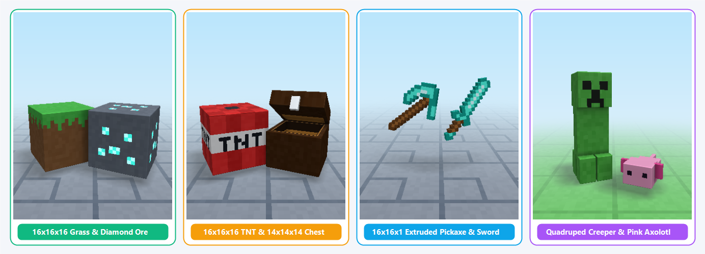
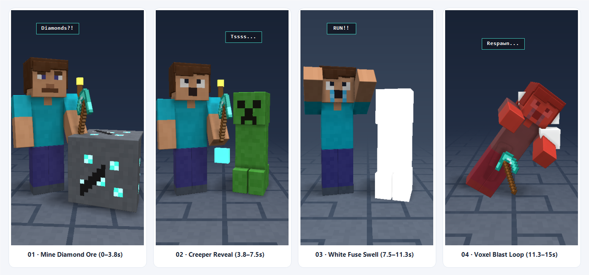
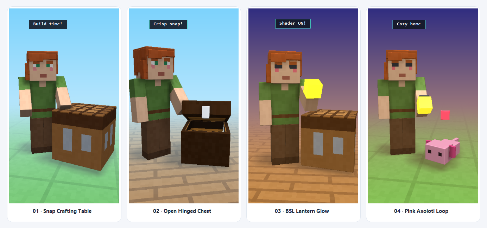
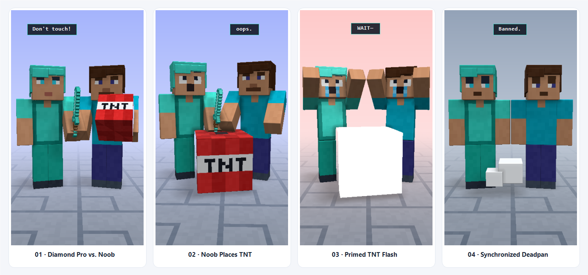

<div align="center">


# Minecraft Style Skill

**English** · [简体中文](README.md)

Generate Minecraft-style voxel character, mob, and block short videos with locked 8x8x8/16x16x16 pixel-grid geometry, 9:16 storyboards, and model-specific prompts.

[](SKILL.md)
[](#command-line-tools)
[](LICENSE)

</div>

Ask a video generator for "a cute Minecraft character mining diamonds" or "building a blocky house," and the clip usually drifts in one of four ways: five human fingers gripping the tool, blurry anti-aliased clay textures instead of crisp `16x16` texels, a smooth cylindrical metal pickaxe, or a rounded Roblox barrel head and Lego C-claws.

`minecraft-style-skill` locks canonical Minecraft pixel-grid geometry across characters, mobs, and world blocks before writing motion prompts: a sharp `8x8x8` cubic head with a `+0.5px` 3D outer skin shell, an `8x12x4` rectangular prism torso, `4x12x4` (Steve wide) or `3x12x4` (Alex slim) arms ending in flat square hands, `16x16x16` nearest-neighbor blocks (`Grass Block`, `Diamond Ore`, `TNT`, `Crafting Table`), `14x14x14` hinged wooden chests with a 3D silver pixel latch, and `16x16x1` extruded pixel-art tools (`Diamond Pickaxe`, `Diamond Sword`). The repository contains [`SKILL.md`](SKILL.md), five reference guides, and four zero-dependency Node.js CLI tools for Kling, Seedance/Jimeng, Hailuo MiniMax, Wan, Sora, and Runway.


## Rendered sheets, voxel objects, and 9:16 previews

All character turnarounds, voxel block/mob sheets, anti-drift boards, 9:16 storyboard contact sheets, and animated previews (`.gif` and `.mp4` with audio) below are rendered locally by the scripts in this repository.

### 1. Three-view character turnaround (`steve_alex_turnaround_sheet.en.png`)

Before running multi-shot image-to-video (I2V), lock the `0° Front`, `45° Three-Quarter`, and `90° Profile` views with a sharp `8x8x8` cube head, `+0.5px` 3D hair bangs, flat `4x4` square hands, and an extruded `16x16x1` Diamond Pickaxe:


### 2. Canonical voxel blocks, extruded tools, and mobs (`voxel_blocks_and_mobs_sheet.en.png`)

Dedicated geometry rules cover the objects and mobs common in 9:16 Minecraft shorts: `16x16x16` Grass Block and glowing Diamond Ore, `16x16x16` TNT and `14x14x14` hinged Oak Chest, extruded `16x16x1` stepped pixel Pickaxe and Sword, plus the armless quadruped Creeper and pink voxel Axolotl:



### 3. Common prompt failures vs. locked Minecraft voxel geometry (`drift_rescue_comparison.en.png`)

Side-by-side comparison of human fingers and 3D noses, blurry smudged textures with round rods, Roblox cylinder heads and Lego C-claws, and locked Minecraft `8x8x8` / `16x16` pixel-grid geometry:


### 4. Three 9:16 vertical short packages (`examples/`)

| Case 01 · Diamond Cave Creeper Ambush (`Kling`) | Case 02 · Cozy Isometric Lantern Build (`Seedance`) | Case 03 · Diamond Pro vs. Noob TNT (`Hailuo`) |
| :---: | :---: | :---: |
|  |  |  |
| `steve-wide` · Cracking Diamond Ore + white Creeper swell | `alex-slim` · Crafting Table, hinged Chest & BSL Lantern | Two-player contrast · 3D Diamond Armor + primed `16x16x16` TNT |
| [Contact Sheet](examples/diamond-creeper-ambush/assets/storyboard_contact_sheet.en.png) · [MP4 Video](examples/diamond-creeper-ambush/assets/diamond_creeper_ambush.mp4) · [Folder](examples/diamond-creeper-ambush/) | [Contact Sheet](examples/cozy-lantern-build/assets/cozy_storyboard_sheet.en.png) · [MP4 Video](examples/cozy-lantern-build/assets/cozy_lantern_build.mp4) · [Folder](examples/cozy-lantern-build/) | [Contact Sheet](examples/pro-builder-vs-noob-tnt/assets/tnt_storyboard_sheet.en.png) · [MP4 Video](examples/pro-builder-vs-noob-tnt/assets/pro_builder_vs_noob_tnt.mp4) · [Folder](examples/pro-builder-vs-noob-tnt/) |

<details>
<summary>Expand to view the English 4-shot storyboard contact sheets</summary>







</details>

## Quick start

Clone the repository into your local Skills folder (works with Claude Code, Codex, Cursor, and GitHub Copilot):

```bash
git clone https://github.com/yuzhang-zhong/minecraft-style-skill.git ~/.codex/skills/minecraft-style-skill
```

Invoke `$minecraft-style-skill` in your agent:

```text
Use $minecraft-style-skill to plan a 15-second 9:16 isometric build short where Alex
snaps a Crafting Table, a hinged Chest, and a glowing Lantern onto a miniature Grass Block cabin
beside a pink Axolotl. Give me the character & block DNA card, reference prompts, and a 4-shot Kling I2V storyboard.
```

You can also use it to rescue a prompt that drifted:

```text
My Kling clip of a Minecraft character holding a diamond sword grew five human fingers and turned the blade into smooth curved metal.
Rewrite the first-frame prompt, motion prompt, and negative prompt for that shot.
```

## Command-line tools

All four scripts run on Node.js 18+ using only the standard library:

- `scripts/voxel_spec.mjs` builds a Character, Mob, and Voxel Block DNA card with `8x8x8` / `16x16x16` pixel dimensions, `+0.5px` 3D skin layers, extruded `16x16x1` tools, a 3-view turnaround prompt, and an isometric block prompt.
- `scripts/shot_compiler.mjs` compiles 9:16 beat sheets, voxel particle cues, and I2V/T2V prompts for `kling`, `seedance`, `hailuo`, `wan`, `sora`, and `runway`.
- `scripts/drift_check.mjs` flags human fingers, smooth non-voxel tools, bilinear texture blur, Roblox/Lego drift, and multi-verb clip overload, then outputs a patched prompt.
- `scripts/render_preview.mjs` renders the 3D turnaround sheets, voxel block/mob boards, bilingual storyboard contact sheets, and `.gif` / `.mp4` previews across CPU worker threads.

```bash
node scripts/voxel_spec.mjs --archetype steve-miner --object diamond-ore --held-item diamond-pickaxe --shader bsl-sunlight --name "Steve" --lang en
node scripts/shot_compiler.mjs --template diamond-creeper-ambush --duration 15 --engine kling --shader rtx-emissive --lang en
node scripts/drift_check.mjs --prompt "A cute Minecraft boy holding a round metal sword with five fingers mines ore and runs away" --engine kling --mode t2v --lang en
node scripts/validate_skill.mjs
```

## Reference guides and scope

To keep `8x8` pixel faces and `16x16` block grids crisp across cuts, generate a 3-view turnaround sheet and static shot keyframes before running I2V, and keep video creativity settings moderate (`0.35` to `0.45` in Kling). Budget one primary character or block action per 4 to 5 second clip. This repository is an independent open-source prompt, storyboard, and voxel preview toolkit and is not affiliated with Mojang Studios or Microsoft.

- [Core workflow and eight voxel invariants (`SKILL.md`)](SKILL.md)
- [Character pixel anatomy, blocks, mobs, and shaders (`references/voxel-geometry-blocks-and-shaders.md`)](references/voxel-geometry-blocks-and-shaders.md)
- [Model prompt playbook (`references/model-prompt-playbook.md`)](references/model-prompt-playbook.md)
- [Drift diagnosis and prompt patches (`references/rescue-and-anti-drift.md`)](references/rescue-and-anti-drift.md)
- [9:16 pacing, isometric angles, and Minecraft audio cues (`references/short-video-beats-and-audio.md`)](references/short-video-beats-and-audio.md)
- [Six short-video story and build templates (`references/viral-archetypes-catalog.md`)](references/viral-archetypes-catalog.md)
