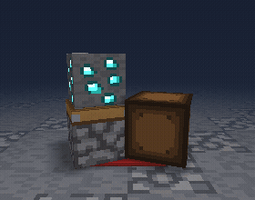

<div align="center">


# Minecraft Style Video

An Agent Skill and offline 3D CLI tool to plan 9:16 vertical Minecraft voxel character & block short videos: lock `8x8x8` character and `16x16x16` block pixel proportions, compile shot-by-shot storyboard prompts for Kling, Seedance, Hailuo, Wan, Sora, or Runway without human-finger drift, and preview 3D animations locally.<br>
《我的世界》（MC）方块小人 9:16 竖屏短视频分镜、本地 3D 动画预览与可灵 / 即梦防崩坏提示词 AI Agent Skill。

[](skills/minecraft-style-video/SKILL.md)
[](#quick-start)
[](LICENSE)

**[Animated examples](#animated-examples)** · [Block & item loops](#voxel-block-and-item-loops) · [Quick start](#quick-start) · [Skill guide](skills/minecraft-style-video/SKILL.md)

**English** · [简体中文](README.zh-CN.md) · [More languages](#languages)

</div>

> **Quick answer:** `minecraft-style-video` is an installable coding-agent Skill and offline CLI for making vertical (`9:16`) blocky voxel character and block short videos **without Blockbench** keyframing, video-model accounts, or API keys—producing local 3D MP4/GIF animatic previews, multi-shot storyboards, and anti-drift prompts (stopping five human fingers on cube hands, blurry pixel textures, or smooth round metal swords).

[](assets/showcase/minecraft_shorts_reel.mp4)

## Animated examples

Each package plans a 15-second, four-shot vertical short. The **4-second GIFs and MP4s** below are local 3D voxel previews for checking framing, pixel-grid proportions, and shot transitions. Model names indicate the compiled prompt format; run those prompts in an external video model for finished diffusion clips. Select any animation to open its MP4 with audio.

| 01 · Diamond Creeper (`Kling`) | 02 · Cozy Lantern Cabin (`Seedance`) | 03 · Pro vs. Noob TNT (`Hailuo`) |
| :---: | :---: | :---: |
| [](examples/diamond-creeper-ambush/assets/diamond_creeper_ambush.mp4) | [](examples/cozy-lantern-build/assets/cozy_lantern_build.mp4) | [](examples/pro-builder-vs-noob-tnt/assets/pro_builder_vs_noob_tnt.mp4) |
| Steve cracks `16x16x16` diamond ore to reveal a swelling Creeper behind the block.<br>[MP4](examples/diamond-creeper-ambush/assets/diamond_creeper_ambush.mp4) · [Storyboard](examples/diamond-creeper-ambush/assets/storyboard_contact_sheet.en.png) · [Prompts](examples/diamond-creeper-ambush/) | Isometric cabin build transitioning from daylight placement to warm BSL lantern light.<br>[MP4](examples/cozy-lantern-build/assets/cozy_lantern_build.mp4) · [Storyboard](examples/cozy-lantern-build/assets/cozy_storyboard_sheet.en.png) · [Prompts](examples/cozy-lantern-build/) | Primed `TNT` flashes white and swells before ending on a synchronized deadpan stare.<br>[MP4](examples/pro-builder-vs-noob-tnt/assets/pro_builder_vs_noob_tnt.mp4) · [Storyboard](examples/pro-builder-vs-noob-tnt/assets/tnt_storyboard_sheet.en.png) · [Prompts](examples/pro-builder-vs-noob-tnt/) |
| **04 · Redstone Piston Chain (`Wan`)** | **05 · Enderman Grass Heist (`Sora`)** | **06 · Rainy Pink Axolotl (`Runway`)** |
| [](examples/redstone-chain-asmr/assets/redstone_chain_asmr.mp4) | [](examples/enderman-block-heist/assets/enderman_block_heist.mp4) | [](examples/axolotl-rainy-shelter/assets/axolotl_rainy_shelter.mp4) |
| Sticky pistons snap diamond blocks into place and trigger cascading Redstone Lamps.<br>[MP4](examples/redstone-chain-asmr/assets/redstone_chain_asmr.mp4) · [Storyboard](examples/redstone-chain-asmr/assets/redstone_storyboard_sheet.en.png) · [Prompts](examples/redstone-chain-asmr/) | A 3-block Enderman plucks a `Grass Block`, vibrates on eye contact, and teleports away.<br>[MP4](examples/enderman-block-heist/assets/enderman_block_heist.mp4) · [Storyboard](examples/enderman-block-heist/assets/enderman_storyboard_sheet.en.png) · [Prompts](examples/enderman-block-heist/) | Cold pixel rain cuts to warm oak block-light and floating heart particles.<br>[MP4](examples/axolotl-rainy-shelter/assets/axolotl_rainy_shelter.mp4) · [Storyboard](examples/axolotl-rainy-shelter/assets/axolotl_storyboard_sheet.en.png) · [Prompts](examples/axolotl-rainy-shelter/) |

## Voxel block and item loops

For object-only shots (redstone contraptions, loot reveals, or isometric block builds), the skill locks sub-block hinges, emissive ore/lamp texels, and extruded `16x16x1` pixel-art tools so video models do not round off edges or turn blades into smooth metal rods:

| Hinged Chest & `16x16x1` Tools | Sticky Piston & Redstone Lamp | Primed `TNT` & Cubic Smoke |
| :---: | :---: | :---: |
| [](assets/showcase/chest_loot_loop.mp4) | [](assets/showcase/piston_ore_loop.mp4) | [](assets/showcase/tnt_blast_loop.mp4) |
| `14x14x14` oak chest + `2x4` silver latch + stepped pickaxe & sword ([MP4](assets/showcase/chest_loot_loop.mp4)) | `16x16x16` sticky piston + glowing `#4AEDD9` ore + lamp ([MP4](assets/showcase/piston_ore_loop.mp4)) | 4Hz white fuse flash + boxy swell + stepped smoke cubes ([MP4](assets/showcase/tnt_blast_loop.mp4)) |

## Quick start

### Use the Agent Skill

Install from GitHub with the official GitHub CLI Skill command:

```bash
gh skill install yuzhang-zhong/minecraft-style-video minecraft-style-video
```

Or install through the cross-agent Skills CLI (Claude Code, Codex, GitHub Copilot, Cursor):

```bash
npx skills add https://github.com/yuzhang-zhong/minecraft-style-video --skill minecraft-style-video
```

You can also clone or copy [`skills/minecraft-style-video/`](skills/minecraft-style-video/) into your agent host's skills directory (such as `~/.codex/skills/minecraft-style-video`, `~/.copilot/skills/minecraft-style-video`, or `~/.claude/skills/minecraft-style-video`).

Invoke `minecraft-style-video` in your agent:

```text
Use $minecraft-style-video to plan a 15-second 9:16 isometric build short where Alex
snaps a Crafting Table, a hinged Chest, and a glowing Lantern onto a Grass Block cabin
beside a pink Axolotl. Give me the block & character DNA card, reference prompts, and a 4-shot Kling I2V storyboard.
```

You can also pass a drifted clip description to generate a prompt patch:

```text
My Kling clip of a Minecraft character holding a diamond sword grew five human fingers and turned the blade into smooth metal.
Rewrite the first-frame prompt, motion prompt, and negative prompt for that shot.
```

### Use the CLI

Run these from the repository root on Node.js 18+ (standard library only, no `npm install` or API keys required):

```bash
node scripts/voxel_spec.mjs --archetype steve-miner --object diamond-ore --held-item diamond-pickaxe --shader bsl-sunlight --name "Steve" --lang en
node scripts/shot_compiler.mjs --template diamond-creeper-ambush --duration 15 --engine kling --shader rtx-emissive --lang en
node scripts/drift_check.mjs --prompt "A cute Minecraft boy holding a round metal sword with five fingers mines ore and runs away" --engine kling --mode t2v --lang en
```

The three commands output a voxel DNA card with turnaround/block prompts, a four-shot 9:16 storyboard, and a corrected prompt that removes human fingers, round metal tools, and multi-verb clip overload.

## CLI scripts, limits, and references

Before running multi-shot image-to-video (I2V), lock the character and block proportions (`8x8x8` cubic head, `8x12x4` torso, `4x12x4` Steve or `3x12x4` Alex flat-square arms, `16x16x16` unfiltered nearest-neighbor blocks, and `16x16x1` extruded tools). Start multi-shot sequences from a [three-view turnaround](assets/showcase/steve_alex_turnaround_sheet.en.png), keep video creativity moderate (`0.35` to `0.45` in Kling) so pixel grids stay crisp, and limit each 4 to 5 second clip to one main action. See the [anti-drift comparison](assets/showcase/drift_rescue_comparison.en.png) and [five-step workflow diagram](docs/pipeline.svg) for common failure modes.

| Script | Output |
| --- | --- |
| [`voxel_spec.mjs`](scripts/voxel_spec.mjs) | Character, mob, and block DNA card with three-view turnaround and isometric block prompts. |
| [`shot_compiler.mjs`](scripts/shot_compiler.mjs) | A 9:16 beat sheet and I2V/T2V prompts for Kling, Seedance, Hailuo, Wan, Sora, and Runway. |
| [`drift_check.mjs`](scripts/drift_check.mjs) | Diagnostic report and patched prompt for human fingers, smooth rods, blurry texels, or action overload. |
| [`render_preview.mjs`](scripts/render_preview.mjs) | Local 3D voxel turnarounds, contact sheets, object loops, GIFs, and MP4s (uses PowerShell `System.Drawing` and `ffmpeg` on Windows). |

[Skill guide (`SKILL.md`)](skills/minecraft-style-video/SKILL.md) · [Voxel geometry, blocks, and shaders](references/voxel-geometry-blocks-and-shaders.md) · [Model prompt playbook](references/model-prompt-playbook.md) · [Drift fixes](references/rescue-and-anti-drift.md) · [Pacing and audio](references/short-video-beats-and-audio.md) · [Story and build templates](references/viral-archetypes-catalog.md) · [Preset catalog](references/classic-minecraft-catalog.md)

## Frequently asked

- **Is this only a static prompt template?** No. It bundles four zero-dependency Node.js CLI tools that lock `8x8x8` / `16x16x16` voxel proportions, lint prompts for style drift, and render local 3D `.mp4` / `.gif` animatics and turnaround sheets before you touch a paid video model.
- **How does it stop AI video models from drawing five human fingers or round swords?** `voxel_spec.mjs` and `drift_check.mjs` enforce flat `4x4` / `3x4` square block hands, `16x16x1` stepped pixel-extruded tools, unfiltered nearest-neighbor texels, and single-action 4s shot budgets.
- **Does it require any API key or npm packages?** No API key or `npm install` is needed for the CLI scripts (Node.js 18+ built-in modules only).
- **Which coding agents and video models does it support?** Works with GitHub Copilot, Claude Code, Codex, Cursor, Gemini CLI (`gh skill install` / `npx skills add`), and compiles prompts for Kling, Seedance/Jimeng, Hailuo, Wan, Sora, and Runway.

## 中文简介

`minecraft-style-video` 是面向 Claude Code、Codex、GitHub Copilot 与 Cursor 的**《我的世界》（Minecraft）体素短视频 Agent Skill 与零依赖 Node.js CLI 工具包**。它在生成前锁定 `8×8×8` 像素方块头、`8×12×4` 躯干、`4×4` 无手指平头方块手、`16×16×16` 像素方块与 `16×16×1` 挤出式像素钻石镐/剑几何不变量，支持本地离线渲染 9:16 竖屏 3D 动态分镜预览（MP4 / GIF / 三视图设定卡），并为可灵（Kling）、即梦（Seedance）、海螺（Hailuo）、通义万相（Wan）、Sora 与 Runway 编译图生视频（I2V）/ 文生视频（T2V）提示词及五指/圆滑金属反漂移修复补丁。覆盖矿洞挖钻石遇苦力怕、末影人偷草块、红石活塞解压 ASMR、微缩木屋与粉美西螈等场景，无需 Blockbench 手动 K 帧，解决史蒂夫长五根真手指、钻石剑变圆铁棍与像素贴图模糊问题。详见[简体中文说明](README.zh-CN.md)与 [`llms.txt`](llms.txt)。

## Languages

Agent replies and CLI `--lang` output support `en`, `zh`, `zh-tw`, `ja`, `ko`, `es`, `fr`, `de`, `pt`, and `ru`.

**English** · [简体中文](README.zh-CN.md) · [繁體中文](docs/i18n/README.zh-TW.md) · [日本語](docs/i18n/README.ja.md) · [한국어](docs/i18n/README.ko.md) · [Español](docs/i18n/README.es.md) · [Français](docs/i18n/README.fr.md) · [Deutsch](docs/i18n/README.de.md) · [Português](docs/i18n/README.pt-BR.md) · [Русский](docs/i18n/README.ru.md)

[MIT License](LICENSE). Independent open-source project, not affiliated with or endorsed by Mojang Studios or Microsoft.
