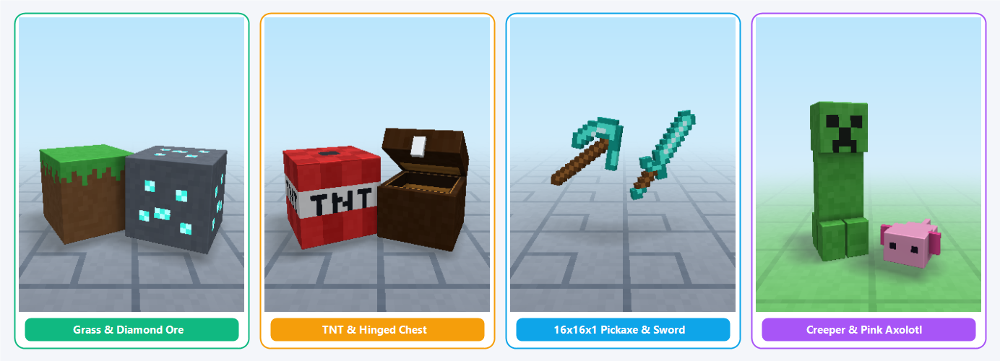
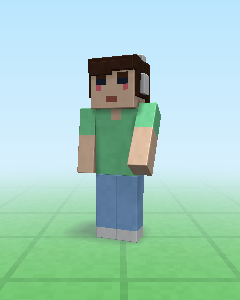
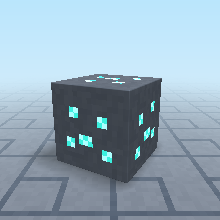

# minecraft-style-video

**English** · [简体中文](README.zh-CN.md) · [繁體中文](docs/i18n/README.zh-TW.md) · [日本語](docs/i18n/README.ja.md) · [한국어](docs/i18n/README.ko.md) · [Español](docs/i18n/README.es.md) · [Français](docs/i18n/README.fr.md) · [Deutsch](docs/i18n/README.de.md) · [Português](docs/i18n/README.pt-BR.md) · [Русский](docs/i18n/README.ru.md)

Generate Minecraft-style voxel character, mob, and block short videos with locked `8x8x8` and `16x16x16` pixel-grid geometry, 9:16 storyboards, and model-specific prompts.

[Quick start](#quick-start) · [6 video examples](#six-916-short-video-examples) · [Asset library](#classic-minecraft-asset-library) · [CLI tools](#command-line-tools) · [Skill workflow](SKILL.md)

Generic "Minecraft character" or "Minecraft block" prompts often cause video generators to grow five human fingers on the hands, smudge `16x16` pixel grids into smooth clay, turn pickaxes into round metal rods, or round the head into a Roblox cylinder with Lego claws. `minecraft-style-video` locks canonical Minecraft proportions before writing motion prompts: a sharp `8x8x8` cubic head with a `+0.5px` 3D outer skin shell, an `8x12x4` rectangular prism torso, `4x12x4` (Steve) or `3x12x4` (Alex) arms ending in flat square hands, `16x16x16` nearest-neighbor blocks, `14x14x14` hinged chests, and `16x16x1` extruded pixel tools.


## Quick start

Clone the repository into your agent's Skills folder (works with Claude Code, Codex, Cursor, and GitHub Copilot):

```bash
git clone https://github.com/yuzhang-zhong/minecraft-style-video.git ~/.codex/skills/minecraft-style-video
```

Keep `SKILL.md`, `references/`, `scripts/`, and `templates/` together when copying into another host such as `.agents/skills/minecraft-style-video`. All four CLI scripts require Node.js 18+ and use only the standard library; `ffmpeg` is needed only when re-rendering `.gif` and `.mp4` previews locally.

Invoke `$minecraft-style-video` in your agent:

```text
Use $minecraft-style-video to plan a 15-second 9:16 isometric build short where Alex
snaps a Crafting Table, a hinged Chest, and a glowing Lantern onto a Grass Block cabin
beside a pink Axolotl. Give me the character & block DNA card, reference prompts, and a 4-shot Kling I2V storyboard.
```

Or pass a broken clip description to patch style drift:

```text
My Kling clip of a Minecraft character holding a diamond sword grew five human fingers and turned the blade into smooth metal.
Rewrite the first-frame prompt, motion prompt, and negative prompt for that shot.
```

## Visual preview and anti-drift check

| 3-View Voxel Turnaround (`0° / 45° / 90°`) | Anti-Drift Geometry Check (`× Drift` vs. `✓ Locked`) |
| :---: | :---: |
|  |  |

<details>
<summary>Expand full-width voxel block, extruded tool, and mob reference sheet</summary>



</details>

## Six 9:16 short-video examples

Six vertical packages rendered by this repository's local preview pipeline, covering all 6 story templates and 6 target video engines:

| 01 · Diamond Creeper (`Kling`) | 02 · Cozy Lantern Cabin (`Seedance`) | 03 · Pro vs. Noob TNT (`Hailuo`) |
| :---: | :---: | :---: |
|  |  |  |
| [Sheet](examples/diamond-creeper-ambush/assets/storyboard_contact_sheet.en.png) · [MP4](examples/diamond-creeper-ambush/assets/diamond_creeper_ambush.mp4) · [Pack](examples/diamond-creeper-ambush/) | [Sheet](examples/cozy-lantern-build/assets/cozy_storyboard_sheet.en.png) · [MP4](examples/cozy-lantern-build/assets/cozy_lantern_build.mp4) · [Pack](examples/cozy-lantern-build/) | [Sheet](examples/pro-builder-vs-noob-tnt/assets/tnt_storyboard_sheet.en.png) · [MP4](examples/pro-builder-vs-noob-tnt/assets/pro_builder_vs_noob_tnt.mp4) · [Pack](examples/pro-builder-vs-noob-tnt/) |
| **04 · Redstone Piston Chain (`Wan`)** | **05 · Enderman Grass Heist (`Sora`)** | **06 · Rainy Pink Axolotl (`Runway`)** |
|  |  |  |
| [Sheet](examples/redstone-chain-asmr/assets/redstone_storyboard_sheet.en.png) · [MP4](examples/redstone-chain-asmr/assets/redstone_chain_asmr.mp4) · [Pack](examples/redstone-chain-asmr/) | [Sheet](examples/enderman-block-heist/assets/enderman_storyboard_sheet.en.png) · [MP4](examples/enderman-block-heist/assets/enderman_block_heist.mp4) · [Pack](examples/enderman-block-heist/) | [Sheet](examples/axolotl-rainy-shelter/assets/axolotl_storyboard_sheet.en.png) · [MP4](examples/axolotl-rainy-shelter/assets/axolotl_rainy_shelter.mp4) · [Pack](examples/axolotl-rainy-shelter/) |

## Classic Minecraft asset library

Pre-rendered in [`assets/library/catalog.json`](assets/library/catalog.json) and documented in [`references/classic-minecraft-catalog.md`](references/classic-minecraft-catalog.md) ([character lineup](assets/showcase/classic_characters_lineup.en.png) · [block & tool atlas](assets/showcase/classic_objects_atlas.en.png)):

| Classic Steve | Slim Alex | Diamond Knight | Cozy Hoodie | Creeper | Enderman |
| :---: | :---: | :---: | :---: | :---: | :---: |
|  |  |  |  |  |  |

| Grass Block | Diamond Ore | TNT Block | Crafting Table | Hinged Chest | Sticky Piston | Pickaxe | Sword |
| :---: | :---: | :---: | :---: | :---: | :---: | :---: | :---: |
|  |  |  |  |  |  |  |  |

## Command-line tools

- [`scripts/voxel_spec.mjs`](scripts/voxel_spec.mjs): generate a Character, Mob, and Voxel Block DNA card with 3-view turnaround and isometric object prompts.
- [`scripts/shot_compiler.mjs`](scripts/shot_compiler.mjs): compile 15s or 30s 9:16 storyboards and I2V/T2V prompts for `kling`, `seedance`, `hailuo`, `wan`, `sora`, and `runway`.
- [`scripts/drift_check.mjs`](scripts/drift_check.mjs): check draft prompts for human fingers, smooth tools, bilinear blur, Roblox/Lego drift, and multi-verb overload, then output a patched prompt.
- [`scripts/render_preview.mjs`](scripts/render_preview.mjs): render local 3D turnaround sheets, asset library thumbnails, storyboard contact sheets, and `.gif` / `.mp4` animatics.

```bash
node scripts/voxel_spec.mjs --archetype steve-miner --object diamond-ore --held-item diamond-pickaxe --shader bsl-sunlight --name "Steve" --lang en
node scripts/shot_compiler.mjs --template diamond-creeper-ambush --duration 15 --engine kling --shader rtx-emissive --lang en
node scripts/drift_check.mjs --prompt "A cute Minecraft boy holding a round metal sword with five fingers mines ore and runs away" --engine kling --mode t2v --lang en
node scripts/validate_skill.mjs
```

## Scope, limits, and references

- **Local preview fixtures vs. cloud video models**: the checked-in `.png`, `.gif`, and `.mp4` files are deterministic local 3D voxel previews rendered by `scripts/render_preview.mjs` to lock composition and verify prompts. Final diffusion video generation requires an external model (Kling, Seedance/Jimeng, Hailuo, Wan, Sora, or Runway).
- **Consistency and pacing**: generate a 3-view turnaround sheet and static shot keyframes before running First-Frame I2V, keep creativity moderate (`0.35` to `0.45` in Kling) so `16x16` pixel grids stay sharp, and limit each 4 to 5 second clip to one primary action.
- **Supported languages**: agent responses and CLI `--lang` output support `en`, `zh`, `zh-tw`, `ja`, `ko`, `es`, `fr`, `de`, `pt`, and `ru`.
- **License and trademark**: MIT ([LICENSE](LICENSE)). Independent open-source toolkit, unaffiliated with Mojang Studios or Microsoft.

Reference guides:

- [Core workflow and eight voxel invariants (`SKILL.md`)](SKILL.md)
- [Voxel geometry, blocks, mobs, and shaders (`references/voxel-geometry-blocks-and-shaders.md`)](references/voxel-geometry-blocks-and-shaders.md)
- [Classic Minecraft character and block catalog (`references/classic-minecraft-catalog.md`)](references/classic-minecraft-catalog.md)
- [Model prompt playbook (`references/model-prompt-playbook.md`)](references/model-prompt-playbook.md)
- [Drift diagnosis and prompt patches (`references/rescue-and-anti-drift.md`)](references/rescue-and-anti-drift.md)
- [9:16 pacing, isometric angles, and audio cues (`references/short-video-beats-and-audio.md`)](references/short-video-beats-and-audio.md)
- [Six short-video story and build templates (`references/viral-archetypes-catalog.md`)](references/viral-archetypes-catalog.md)

