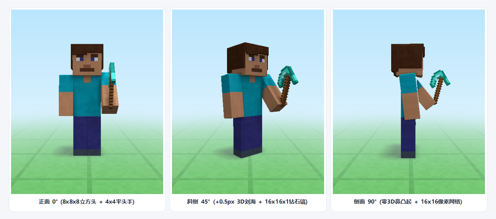
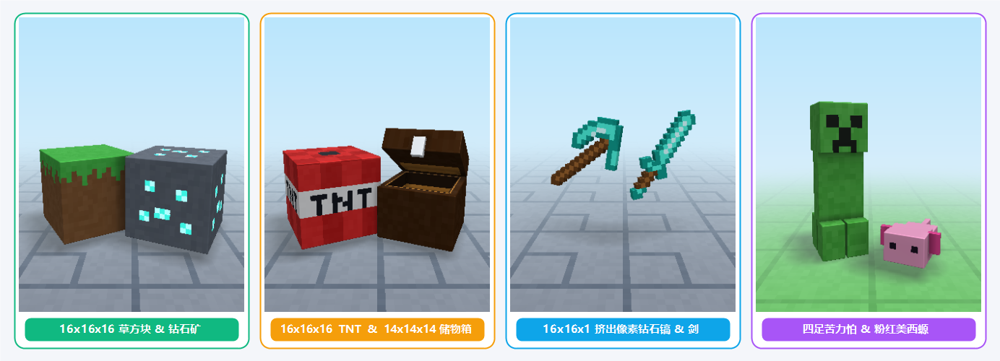
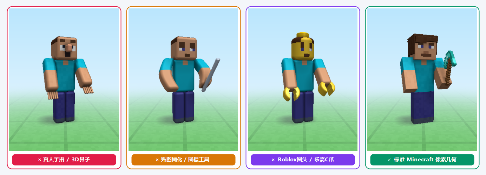
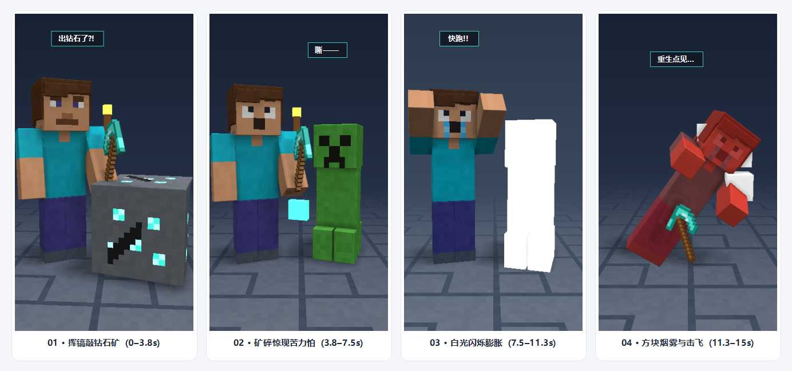
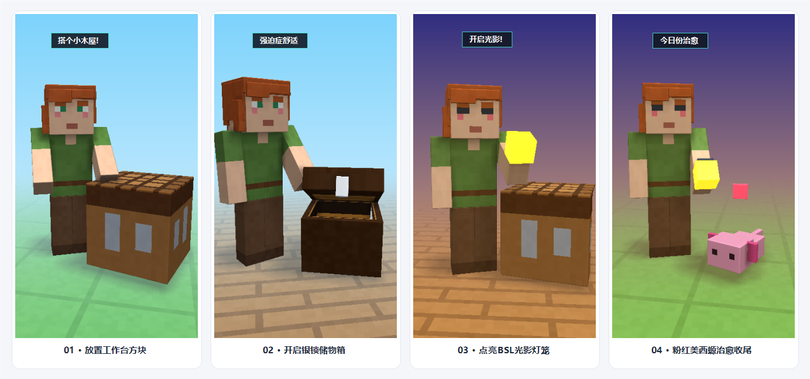
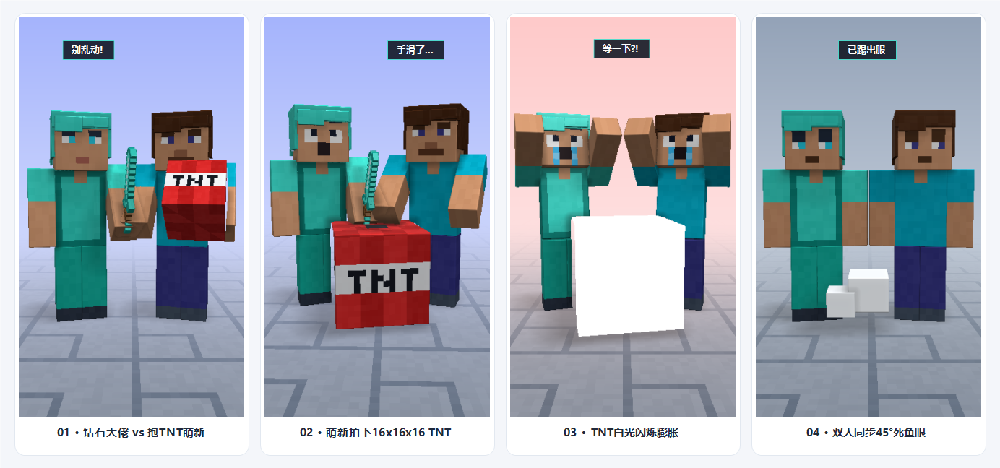

<div align="center">


# Minecraft Style Skill

**简体中文** · [English](README.en.md)

Generate Minecraft-style voxel character, mob, and block short videos with locked 8x8x8/16x16x16 pixel-grid geometry, 9:16 storyboards, and model-specific prompts.

[](SKILL.md)
[](#命令行工具)
[](LICENSE)

</div>

直接让视频模型生成「我的世界小人拿钻石镐挖矿」或「搭一座方块小屋」，画面很容易出现四种跑偏：握工具时手部长出五根真人手指、方块表面的 `16×16` 像素格被涂抹成模糊泥塑、钻石镐和钻石剑退化成圆棍金属刀刃，或者脑袋串味成 Roblox 圆桶头与乐高头顶凸粒。

`minecraft-style-skill` 在写分镜前先把《我的世界》的角色、生物与方块物体几何规则锁死：`8×8×8` 锋利直角立方体头、`+0.5px` 悬浮 3D 外层皮肤（刘海、帽兜、头盔）、`8×12×4` 躯干、末端为 `4×4`（Steve 宽臂）或 `3×4`（Alex 细臂）平头正方形截面的长方体四肢、`16×16×16` 邻近采样像素方块（草方块、发光钻石矿、TNT、工作台）、`14×14×14` 可开合银锁储物箱，以及 `16×16×1` 阶梯锯齿挤出像素道具（钻石镐、钻石剑）。仓库包含 [`SKILL.md`](SKILL.md)、五份参考手册和四个零依赖 Node.js 脚本，可直接输出三视图与方块设定卡、9:16 竖屏分镜、多模型图生视频（I2V）提示词及本地 3D 体素预览短片。


## 渲染样片与体素防跑偏对比

以下角色三视图、方块与生物设定卡、防串味对比图、9:16 分镜联系表及动态短片（`.gif` 与带音效 `.mp4`）均由本仓库脚本实际渲染并检入仓库。

### 1. 角色三视图与双层像素皮肤设定卡 (`steve_alex_turnaround_sheet.zh.png`)

在跑多镜头图生视频前，先固定 0° 正面、45° 斜侧、90° 正侧面三视图，锁住 `8×8×8` 立方体头、`+0.5px` 3D 立体刘海层、平头 `4×4` 方手与向前握持的 `16×16×1` 锯齿像素钻石镐：



### 2. 方块物体、挤出像素道具与原版生物设定卡 (`voxel_blocks_and_mobs_sheet.zh.png`)

除人物外，内置规则同时覆盖短视频高频出镜的方块与生物几何：`16×16×16` 草方块与发光钻石矿、`16×16×16` 红白 TNT 与 `14×14×14` 上翻盖银锁储物箱、`16×16×1` 挤出厚度像素钻石镐/剑，以及无手臂四足苦力怕与粉红像素美西螈：



### 3. 四类常见跑偏与标准 Minecraft 体素对比 (`drift_rescue_comparison.zh.png`)

直观对比真人五指与立体鼻、贴图糊化与圆棍金属工具、Roblox 圆桶头与乐高钩爪，以及锁定 `8×8×8` / `16×16` 邻近采样像素网格后的标准效果：



### 4. 三套 9:16 竖屏短片样例 (`examples/`)

| Case 01 · 挖到钻石秒遇苦力怕 (`Kling`) | Case 02 · 微缩方块木屋建造 (`Seedance`) | Case 03 · 钻石大佬 vs 萌新拍 TNT (`Hailuo`) |
| :---: | :---: | :---: |
|  |  |  |
| `steve-wide` · 钻石矿碎裂 + 苦力怕白光膨胀 | `alex-slim` · 工作台/储物箱拼搭 + BSL 灯笼光影 | 双人反差 · 3D 钻石甲大佬 + `16×16×16` TNT 闪烁 |
| [中文分镜表](examples/diamond-creeper-ambush/assets/storyboard_contact_sheet.zh.png) · [MP4 视频](examples/diamond-creeper-ambush/assets/diamond_creeper_ambush.mp4) · [目录](examples/diamond-creeper-ambush/) | [中文分镜表](examples/cozy-lantern-build/assets/cozy_storyboard_sheet.zh.png) · [MP4 视频](examples/cozy-lantern-build/assets/cozy_lantern_build.mp4) · [目录](examples/cozy-lantern-build/) | [中文分镜表](examples/pro-builder-vs-noob-tnt/assets/tnt_storyboard_sheet.zh.png) · [MP4 视频](examples/pro-builder-vs-noob-tnt/assets/pro_builder_vs_noob_tnt.mp4) · [目录](examples/pro-builder-vs-noob-tnt/) |

<details>
<summary>展开查看三套案例的中文 4 镜头分镜联系表大图</summary>







</details>

## 安装与使用

将仓库克隆到本地 Skills 目录（支持 Claude Code、Codex、Cursor 和 GitHub Copilot）：

```bash
git clone https://github.com/yuzhang-zhong/minecraft-style-skill.git ~/.codex/skills/minecraft-style-skill
```

在对话里调用 `$minecraft-style-skill` 生成小人剧场或微缩方块建造短片：

```text
使用 $minecraft-style-skill 做一个 15 秒的 9:16 竖屏短片，主题是「在桌面搭一座带发光灯笼和粉红美西螈的微缩方块木屋」，
先用即梦出首帧图再用可灵跑图生视频。请给出角色与方块物体设定卡、三视图提示词和 4 镜头分镜表。
```

如果生成的视频出现了真人手指、贴图糊化或圆滑铁剑，可以直接把原提示词交由它修补：

```text
我用可灵跑了一镜「我的世界小人手拿钻石剑砍向苦力怕」，结果手部长出了五根手指，剑也变成了圆滑发光铁剑，帮我重写首帧词、动态词和负向词。
```

## 命令行工具

四个脚本只使用 Node.js 18+ 标准库，无需安装第三方依赖或配置 API Key：

- `scripts/voxel_spec.mjs` 按 7 种角色与生物预设（Steve、Alex、钻石甲骑士、卫衣小人、苦力怕、末影人、美西螈）、8 种方块道具与 4 种光影风格生成设定卡、三视图提示词与等距方块提示词。
- `scripts/shot_compiler.mjs` 按 6 套竖屏短片模板、时长和目标模型（`kling`、`seedance`、`hailuo`、`wan`、`sora`、`runway`）编译分镜表与首帧 I2V 提示词。
- `scripts/drift_check.mjs` 检查草稿提示词里的真人五指、圆棍非像素工具、贴图双线性模糊、Roblox/乐高串味和单镜多动作超载，并输出救场重写版。
- `scripts/render_preview.mjs` 使用内置多核 3D 邻近像素光线步进渲染器，在本地生成角色三视图、方块与生物设定卡、防串味对比图、中英分镜表及 `.gif` / `.mp4` 样片。

```bash
node scripts/voxel_spec.mjs --archetype steve-miner --object diamond-ore --held-item diamond-pickaxe --shader bsl-sunlight --name "Steve" --lang zh-en
node scripts/shot_compiler.mjs --template diamond-creeper-ambush --duration 15 --engine kling --shader rtx-emissive --lang zh-en
node scripts/drift_check.mjs --prompt "A cute Minecraft boy holding a round metal sword with five fingers mines ore and runs away" --engine kling --mode t2v --lang zh-en
node scripts/validate_skill.mjs
```

## 参考文档与边界说明

多镜头短片要防止 `8×8` 像素五官与 `16×16` 方块网格在切镜时糊化变形，建议先生成角色三视图和方块物体设定图，固定各镜首帧后再走图生视频（I2V），并将可灵等模型的创意度控制在 `0.35` 至 `0.45` 之间。单个 4 到 5 秒片段只安排一个核心肢体或方块交互动作，连续复杂剧情请拆成多个分镜。本项目是独立开源提示词、分镜与体素预览工具，与 Mojang Studios 或 Microsoft 无官方关联。

- [Skill 工作流与八项体素不变量 (`SKILL.md`)](SKILL.md)
- [角色像素比例、双层皮肤、方块道具与光影规范 (`references/voxel-geometry-blocks-and-shaders.md`)](references/voxel-geometry-blocks-and-shaders.md)
- [可灵、即梦、海螺、万相、Sora、Runway 提示词写法 (`references/model-prompt-playbook.md`)](references/model-prompt-playbook.md)
- [八类跑偏症状诊断与提示词修补示例 (`references/rescue-and-anti-drift.md`)](references/rescue-and-anti-drift.md)
- [9:16 竖屏节奏、等距微缩机位与原版音效卡点 (`references/short-video-beats-and-audio.md`)](references/short-video-beats-and-audio.md)
- [六套竖屏短片剧场模板 (`references/viral-archetypes-catalog.md`)](references/viral-archetypes-catalog.md)
