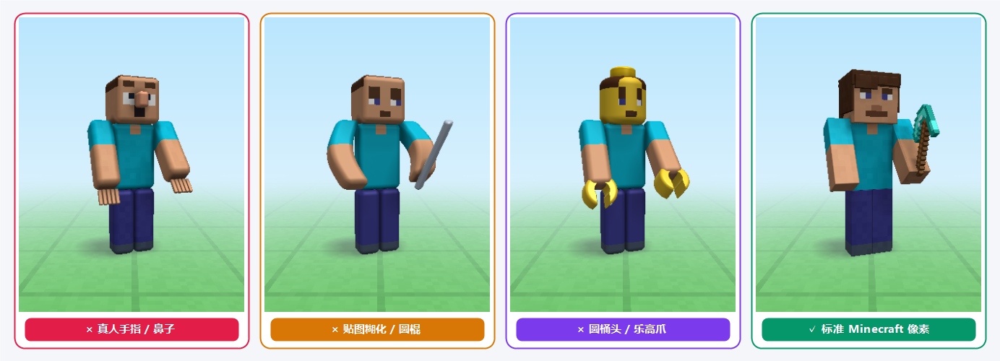

# minecraft-style-video

[English](README.md) · **简体中文** · [繁體中文](docs/i18n/README.zh-TW.md) · [日本語](docs/i18n/README.ja.md) · [한국어](docs/i18n/README.ko.md) · [Español](docs/i18n/README.es.md) · [Français](docs/i18n/README.fr.md) · [Deutsch](docs/i18n/README.de.md) · [Português](docs/i18n/README.pt-BR.md) · [Русский](docs/i18n/README.ru.md)

锁定《我的世界》`8×8×8` 角色与 `16×16×16` 方块像素网格比例，生成 9:16 竖屏短视频分镜、三视图设定与多模型提示词。

[快速开始](#快速开始) · [6 套短片案例](#6-套-916-竖屏短片案例) · [经典素材库](#minecraft-经典角色生物与方块素材库) · [命令行工具](#命令行工具) · [Skill 规范](SKILL.md)

直接让视频模型生成「我的世界小人挖钻石」或「搭方块木屋」，画面常出现四类跑偏：握工具时手部长出五根真人手指、方块表面的 `16×16` 像素格被涂抹成模糊泥塑、镐子和剑退化成圆棍金属刀刃，或者头部串味成 Roblox 圆桶头与乐高钩爪。`minecraft-style-video` 在写分镜前先把体素与方块几何锁死：`8×8×8` 直角立方体头、`+0.5px` 悬浮 3D 外层皮肤、`8×12×4` 躯干、末端为 `4×4`（Steve）或 `3×4`（Alex）平头正方形截面的长方体手臂、`16×16×16` 邻近采样方块、`14×14×14` 上翻盖银锁储物箱与 `16×16×1` 阶梯挤出像素工具。


## 快速开始

克隆到本地 Skills 目录（支持 Claude Code、Codex、Cursor 和 GitHub Copilot）：

```bash
git clone https://github.com/yuzhang-zhong/minecraft-style-video.git ~/.codex/skills/minecraft-style-video
```

若复制到 `.agents/skills/minecraft-style-video` 等其他宿主目录，请保留同级的 `SKILL.md`、`references/`、`scripts/` 和 `templates/`。四个命令行脚本仅依赖 Node.js 18+ 标准库；只有在本地重新合成 `.gif` 和 `.mp4` 预览样片时才需要 `ffmpeg`。

在 Agent 中调用 `$minecraft-style-video`：

```text
使用 $minecraft-style-video 做一个 15 秒 9:16 等距建造短片，主题是「Alex 在草方块木屋放上工作台、银锁储物箱和发光灯笼，旁边趴着粉红美西螈」，
先用即梦出首帧图再用可灵跑图生视频。请给出角色与方块设定卡、参考图提示词和 4 镜头分镜表。
```

也可以直接把跑偏的提示词交由它修补：

```text
我用可灵跑了一镜「我的世界小人手拿钻石剑砍向苦力怕」，结果长出了五根真人手指，剑也变成了圆滑发光铁剑，帮我重写这镜的首帧词、动态词和负向词。
```

## 效果预览与防串味对比

| 角色三视图设定卡 (`0° / 45° / 90°`) | 防串味几何对比 (`× 跑偏` vs. `✓ 标准像素`) |
| :---: | :---: |
|  |  |

<details>
<summary>展开查看方块、挤出像素工具与原版生物设定大图</summary>


</details>

## 6 套 9:16 竖屏短片案例

仓库内置渲染器生成的 6 套竖屏短片包，覆盖全部 6 种剧场/建造模板与 6 款目标视频模型：

| 01 · 挖钻石遇苦力怕 (`Kling`) | 02 · 微缩木屋点亮灯笼 (`Seedance`) | 03 · 钻石大佬 vs 萌新拍 TNT (`Hailuo`) |
| :---: | :---: | :---: |
|  |  |  |
| [分镜表](examples/diamond-creeper-ambush/assets/storyboard_contact_sheet.zh.png) · [MP4](examples/diamond-creeper-ambush/assets/diamond_creeper_ambush.mp4) · [目录](examples/diamond-creeper-ambush/) | [分镜表](examples/cozy-lantern-build/assets/cozy_storyboard_sheet.zh.png) · [MP4](examples/cozy-lantern-build/assets/cozy_lantern_build.mp4) · [目录](examples/cozy-lantern-build/) | [分镜表](examples/pro-builder-vs-noob-tnt/assets/tnt_storyboard_sheet.zh.png) · [MP4](examples/pro-builder-vs-noob-tnt/assets/pro_builder_vs_noob_tnt.mp4) · [目录](examples/pro-builder-vs-noob-tnt/) |
| **04 · 红石粘性活塞连环 (`Wan`)** | **05 · 末影人半夜偷草块 (`Sora`)** | **06 · 雨夜收留粉美西螈 (`Runway`)** |
|  |  |  |
| [分镜表](examples/redstone-chain-asmr/assets/redstone_storyboard_sheet.zh.png) · [MP4](examples/redstone-chain-asmr/assets/redstone_chain_asmr.mp4) · [目录](examples/redstone-chain-asmr/) | [分镜表](examples/enderman-block-heist/assets/enderman_storyboard_sheet.zh.png) · [MP4](examples/enderman-block-heist/assets/enderman_block_heist.mp4) · [目录](examples/enderman-block-heist/) | [分镜表](examples/axolotl-rainy-shelter/assets/axolotl_storyboard_sheet.zh.png) · [MP4](examples/axolotl-rainy-shelter/assets/axolotl_rainy_shelter.mp4) · [目录](examples/axolotl-rainy-shelter/) |

## Minecraft 经典角色、生物与方块素材库

预渲染于 [`assets/library/catalog.json`](assets/library/catalog.json)，参数说明见 [`references/classic-minecraft-catalog.md`](references/classic-minecraft-catalog.md)（[角色生物大图](assets/showcase/classic_characters_lineup.zh.png) · [方块道具大图](assets/showcase/classic_objects_atlas.zh.png)）：

| 矿工 Steve | 建筑师 Alex | 3D 钻石甲大佬 | 3D 卫衣耳机 | 四足苦力怕 | 抱草块末影人 |
| :---: | :---: | :---: | :---: | :---: | :---: |
|  |  |  |  |  |  |

| 草方块 | 钻石矿石 | TNT 炸药 | 工作台 | 银锁储物箱 | 粘性活塞 | 像素钻石镐 | 像素钻石剑 |
| :---: | :---: | :---: | :---: | :---: | :---: | :---: | :---: |
|  |  |  |  |  |  |  |  |

## 命令行工具

- [`scripts/voxel_spec.mjs`](scripts/voxel_spec.mjs)：生成角色、生物与方块物体 DNA 设定卡，输出三视图提示词与等距方块提示词。
- [`scripts/shot_compiler.mjs`](scripts/shot_compiler.mjs)：按 6 套模板编译 15 秒或 30 秒 9:16 分镜表，输出适配 `kling`、`seedance`、`hailuo`、`wan`、`sora`、`runway` 的提示词。
- [`scripts/drift_check.mjs`](scripts/drift_check.mjs)：检查真人五指、圆棍非像素工具、贴图糊化、Roblox/乐高串味与单镜动作超载，并输出修正版提示词。
- [`scripts/render_preview.mjs`](scripts/render_preview.mjs)：在本地渲染 3D 三视图、经典素材库缩略图、双语分镜表和 `.gif` / `.mp4` 动态样片。

```bash
node scripts/voxel_spec.mjs --archetype steve-miner --object diamond-ore --held-item diamond-pickaxe --shader bsl-sunlight --name "Steve" --lang zh
node scripts/shot_compiler.mjs --template diamond-creeper-ambush --duration 15 --engine kling --shader rtx-emissive --lang zh
node scripts/drift_check.mjs --prompt "A cute Minecraft boy holding a round metal sword with five fingers mines ore and runs away" --engine kling --mode t2v --lang zh
node scripts/validate_skill.mjs
```

## 生成边界与参考文档

- **本地体素预览与外部视频模型的边界**：检入仓库的 `.png`、`.gif` 和 `.mp4` 由本地确定性 3D 渲染器生成，用于验证构图、节奏与像素比例锚点；实际扩散视频成片需在可灵、即梦、海螺、万相、Sora 或 Runway 等外部模型中生成。
- **像素网格稳定与动作节奏**：多镜头短片请先生成角色三视图与各镜静态首帧再走图生视频（I2V），可灵创意度建议保持在 `0.35` 至 `0.45`，每个 4 到 5 秒镜头只放一个核心动作。
- **多语言支持**：Agent 回复与命令行 `--lang` 参数支持 `en`、`zh`、`zh-tw`、`ja`、`ko`、`es`、`fr`、`de`、`pt`、`ru` 共 10 种语言。
- **许可与声明**：MIT（见 [LICENSE](LICENSE)）。本项目是独立开源工具，与 Mojang Studios 或 Microsoft 无官方关联。

参考指南：

- [Skill 工作流与八项体素不变量 (`SKILL.md`)](SKILL.md)
- [角色像素比例、双层皮肤、方块道具与光影规范 (`references/voxel-geometry-blocks-and-shaders.md`)](references/voxel-geometry-blocks-and-shaders.md)
- [经典角色、生物与方块道具目录 (`references/classic-minecraft-catalog.md`)](references/classic-minecraft-catalog.md)
- [多模型提示词手册 (`references/model-prompt-playbook.md`)](references/model-prompt-playbook.md)
- [常见跑偏诊断与修补示例 (`references/rescue-and-anti-drift.md`)](references/rescue-and-anti-drift.md)
- [9:16 竖屏节奏、等距机位与原版音效 (`references/short-video-beats-and-audio.md`)](references/short-video-beats-and-audio.md)
- [六套竖屏短片剧场与建造模板 (`references/viral-archetypes-catalog.md`)](references/viral-archetypes-catalog.md)
