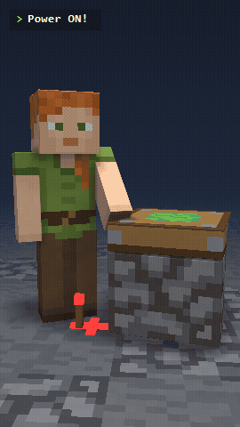

<div align="center">


# Minecraft Style Video

做一支 9:16《我的世界》体素短片：固定 `8×8×8` 小人与 `16×16×16` 方块比例，逐镜编译提示词，先在本地看一遍动态分镜。

[](skills/minecraft-style-video/SKILL.md)
[](#安装与开始)
[](LICENSE)

**[短片动画示例](#短片动画示例)** · [方块与道具动效](#方块与道具动效) · [安装与开始](#安装与开始) · [Skill 指南](skills/minecraft-style-video/SKILL.md)

[English](README.md) · **简体中文** · [更多语言](#语言)

</div>

> **一句话速览：** `minecraft-style-video` 是可一键安装的《我的世界》（MC）体素短视频 Agent Skill 与零依赖 Node.js 本地 3D 预览工具：无需视频平台账号或 API Key，即可渲染 9:16 竖屏本地 MP4/GIF 动态分镜（挖矿遇苦力怕、末影人偷草块、红石活塞解压 ASMR、微缩木屋与美西螈等），锁死 `8×8×8` 小人与 `16×16×16` 像素比例，防止可灵、即梦、海螺、万相、Sora、Runway 把方块手画成五根真手指、把钻石剑磨成圆铁棍或把像素贴图糊成一片。

[](assets/showcase/minecraft_shorts_reel.mp4)

## 短片动画示例

每份分镜按 15 秒、4 镜头规划。下方的 **4 秒 GIF 与 MP4** 是本地确定性 3D 体素预览，用来检查角色像素比例、镜头切换和方块光影。括号里的模型名指提示词适配的格式，最终扩散视频成片需在对应外部视频模型中运行生成。点击任意动图可打开带音效的 MP4。

| 01 · 挖钻石遇苦力怕 (`Kling`) | 02 · 微缩木屋点亮灯笼 (`Seedance`) | 03 · 钻石大佬 vs 萌新 TNT (`Hailuo`) |
| :---: | :---: | :---: |
| [](examples/diamond-creeper-ambush/assets/diamond_creeper_ambush.mp4) | [](examples/cozy-lantern-build/assets/cozy_lantern_build.mp4) | [](examples/pro-builder-vs-noob-tnt/assets/pro_builder_vs_noob_tnt.mp4) |
| 敲碎 `16×16×16` 钻石矿露出苦力怕，引信白光膨胀衔接击飞循环。<br>[MP4](examples/diamond-creeper-ambush/assets/diamond_creeper_ambush.mp4) · [分镜图](examples/diamond-creeper-ambush/assets/storyboard_contact_sheet.zh.png) · [提示词包](examples/diamond-creeper-ambush/) | 45° 等距木屋拼搭，从白天摆放到挂起 BSL 暖光灯笼。<br>[MP4](examples/cozy-lantern-build/assets/cozy_lantern_build.mp4) · [分镜图](examples/cozy-lantern-build/assets/cozy_storyboard_sheet.zh.png) · [提示词包](examples/cozy-lantern-build/) | 点燃的 `TNT` 白光闪烁膨胀，收尾双人同步转头盯向镜头。<br>[MP4](examples/pro-builder-vs-noob-tnt/assets/pro_builder_vs_noob_tnt.mp4) · [分镜图](examples/pro-builder-vs-noob-tnt/assets/tnt_storyboard_sheet.zh.png) · [提示词包](examples/pro-builder-vs-noob-tnt/) |
| **04 · 红石粘性活塞连环 (`Wan`)** | **05 · 末影人半夜偷草块 (`Sora`)** | **06 · 雨夜收留粉美西螈 (`Runway`)** |
| [](examples/redstone-chain-asmr/assets/redstone_chain_asmr.mp4) | [](examples/enderman-block-heist/assets/enderman_block_heist.mp4) | [](examples/axolotl-rainy-shelter/assets/axolotl_rainy_shelter.mp4) |
| 粘性活塞分步推合钻石块，触发多米诺红石灯逐格亮起。<br>[MP4](examples/redstone-chain-asmr/assets/redstone_chain_asmr.mp4) · [分镜图](examples/redstone-chain-asmr/assets/redstone_storyboard_sheet.zh.png) · [提示词包](examples/redstone-chain-asmr/) | 3 格高末影人拔走草方块，对视瞬间张开方形下颚震动并瞬移。<br>[MP4](examples/enderman-block-heist/assets/enderman_block_heist.mp4) · [分镜图](examples/enderman-block-heist/assets/enderman_storyboard_sheet.zh.png) · [提示词包](examples/enderman-block-heist/) | 从冷蓝像素雨丝切入橡木屋暖黄方块光源与上升爱心粒子。<br>[MP4](examples/axolotl-rainy-shelter/assets/axolotl_rainy_shelter.mp4) · [分镜图](examples/axolotl-rainy-shelter/assets/axolotl_storyboard_sheet.zh.png) · [提示词包](examples/axolotl-rainy-shelter/) |

## 方块与道具动效

针对纯物体镜头（红石机关、开箱爆装、微缩方块拼搭），规则专门锁死箱盖转轴、矿石/红石灯自发光像素以及 `16×16×1` 阶梯挤出工具厚度，避免视频模型把方块边缘磨圆或把像素镐变成光滑铁棍：

| 银锁储物箱与 `16×16×1` 像素工具 | 粘性活塞与红石灯通电 | `TNT` 引信闪烁与方块烟雾 |
| :---: | :---: | :---: |
| [](assets/showcase/chest_loot_loop.mp4) | [](assets/showcase/piston_ore_loop.mp4) | [](assets/showcase/tnt_blast_loop.mp4) |
| `14×14×14` 上翻盖木箱 + `2×4` 银锁 + 锯齿镐剑（[MP4](assets/showcase/chest_loot_loop.mp4)） | `16×16×16` 粘性活塞 + `#4AEDD9` 钻石矿 + 红石灯（[MP4](assets/showcase/piston_ore_loop.mp4)） | 4Hz 白光闪烁 + 正方体膨胀 + 方块烟雾粒子（[MP4](assets/showcase/tnt_blast_loop.mp4)） |

## 安装与开始

### 作为 Agent Skill 使用

克隆到宿主的 Skills 目录。下方路径用于 Codex；GitHub Copilot 使用 `~/.copilot/skills/minecraft-style-video`，Claude Code 和 Cursor 使用各自配置的 Skills 目录。

```bash
git clone https://github.com/yuzhang-zhong/minecraft-style-video.git ~/.codex/skills/minecraft-style-video
```

在对话里调用 `minecraft-style-video`：

```text
使用 $minecraft-style-video 规划一支 15 秒 9:16 等距建造短片，主题是「Alex 在草方块木屋放上工作台、银锁储物箱和发光灯笼，旁边趴着粉红美西螈」，
先用即梦出首帧图再用可灵跑图生视频。请给出方块与角色设定卡、参考图提示词和 4 镜头分镜表。
```

生成画面跑偏时，可以直接把情况交由它修补提示词：

```text
我用可灵跑了一镜「我的世界小人手拿钻石剑砍向苦力怕」，结果手部长出了五根手指，剑也变成了圆滑发光铁剑，帮我重写这镜的首帧词、动态词和负向词。
```

### 直接使用命令行

在仓库根目录运行（仅需 Node.js 18+ 标准库，无需 `npm install` 或 API Key）：

```bash
node scripts/voxel_spec.mjs --archetype steve-miner --object diamond-ore --held-item diamond-pickaxe --shader bsl-sunlight --name "Steve" --lang zh
node scripts/shot_compiler.mjs --template diamond-creeper-ambush --duration 15 --engine kling --shader rtx-emissive --lang zh
node scripts/drift_check.mjs --prompt "A cute Minecraft boy holding a round metal sword with five fingers mines ore and runs away" --engine kling --mode t2v --lang zh
```

三条命令依次输出角色与方块设定卡、四镜头 9:16 分镜表，以及一份剔除真人五指、圆棍金属剑和动作超载的修正提示词。

## 命令行脚本、限制与参考文档

跑多镜头图生视频（I2V）前，先固定像素网格比例（`8×8×8` 直角立方头、`8×12×4` 躯干、`4×12×4` Steve 或 `3×12×4` Alex 平头方臂、`16×16×16` 邻近采样方块与 `16×16×1` 挤出像素工具）。建议先用[角色三视图](assets/showcase/steve_alex_turnaround_sheet.zh.png)锚定首帧，可灵创意度控制在 `0.35` 至 `0.45` 以保持像素边缘清晰，每个 4 至 5 秒片段只安排一个主要动作。常见跑偏细节见[防串味对比图](assets/showcase/drift_rescue_comparison.zh.png)与[五步工作流图](docs/pipeline.zh.svg)。

| 脚本 | 输出 |
| --- | --- |
| [`voxel_spec.mjs`](scripts/voxel_spec.mjs) | 角色、生物与方块 DNA 设定卡，含三视图与等距方块提示词。 |
| [`shot_compiler.mjs`](scripts/shot_compiler.mjs) | 9:16 分镜表，适配可灵、即梦、海螺、通义万相、Sora 与 Runway 的 I2V/T2V 提示词。 |
| [`drift_check.mjs`](scripts/drift_check.mjs) | 检查真人五指、圆棍工具、贴图糊化与单镜动作过多，输出修补版提示词。 |
| [`render_preview.mjs`](scripts/render_preview.mjs) | 本地渲染 3D 三视图、分镜表、方块循环动效、GIF 和 MP4（Windows 合成使用 PowerShell `System.Drawing` 与 `ffmpeg`）。 |

[Skill 指南 (`SKILL.md`)](skills/minecraft-style-video/SKILL.md) · [体素比例、方块与光影规范](references/voxel-geometry-blocks-and-shaders.md) · [各模型提示词手册](references/model-prompt-playbook.md) · [跑偏诊断与修补](references/rescue-and-anti-drift.md) · [竖屏节奏与原版音效](references/short-video-beats-and-audio.md) · [六套短片与建造模板](references/viral-archetypes-catalog.md) · [预设参数目录](references/classic-minecraft-catalog.md)

## 常见问题

- **这只是一份静态提示词模板吗？** 不是。仓库自带四个零依赖 Node.js 脚本，先锁定 `8×8×8` / `16×16×16` 体素比例、自动拦截五根手指与圆滑金属等串味提示词，并在本地渲染 3D `.mp4` / `.gif` 动态分镜和三视图设定卡。
- **如何一键安装到 Claude Code、Codex、GitHub Copilot 或 Cursor？** 运行 `gh skill install yuzhang-zhong/minecraft-style-video minecraft-style-video` 或 `npx skills add https://github.com/yuzhang-zhong/minecraft-style-video --skill minecraft-style-video`。
- **本地运行需要视频平台 API Key 或 `npm install` 吗？** 均不需要，Node.js 18+ 标准库即可直接运行全部规划与检查命令。

## 语言

Agent 回复与命令行 `--lang` 支持 `en`、`zh`、`zh-tw`、`ja`、`ko`、`es`、`fr`、`de`、`pt`、`ru`。

[English](README.md) · **简体中文** · [繁體中文](docs/i18n/README.zh-TW.md) · [日本語](docs/i18n/README.ja.md) · [한국어](docs/i18n/README.ko.md) · [Español](docs/i18n/README.es.md) · [Français](docs/i18n/README.fr.md) · [Deutsch](docs/i18n/README.de.md) · [Português](docs/i18n/README.pt-BR.md) · [Русский](docs/i18n/README.ru.md)

[MIT 许可证](LICENSE)。独立开源项目，与 Mojang Studios 或 Microsoft 无隶属或背书关系。
