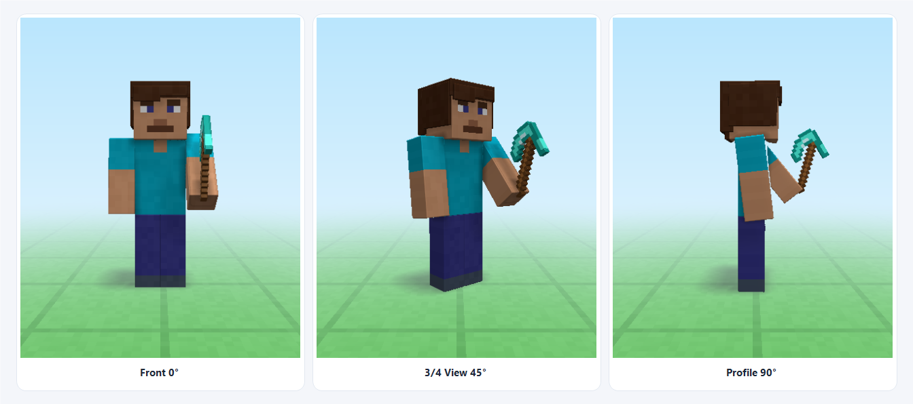
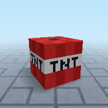
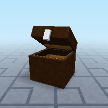

# minecraft-style-video

[English](../../README.md) · [简体中文](../../README.zh-CN.md) · [繁體中文](README.zh-TW.md) · [日本語](README.ja.md) · [한국어](README.ko.md) · **Español** · [Français](README.fr.md) · [Deutsch](README.de.md) · [Português](README.pt-BR.md) · [Русский](README.ru.md)

Genera videos cortos verticales 9:16 de personajes, criaturas y bloques estilo Minecraft fijando la geometría voxel `8x8x8` y `16x16x16` junto con prompts específicos por modelo.

Los prompts genéricos como "personaje de Minecraft picando diamantes" suelen producir manos con cinco dedos humanos, texturas borrosas tipo plastilina, picos cilíndricos lisos o cabezas redondeadas estilo Roblox con garras de Lego. `minecraft-style-video` fija las proporciones antes de animar: cabeza cúbica `8x8x8` con capa exterior 3D `+0.5px`, torso `8x12x4`, brazos `4x12x4` (Steve) o `3x12x4` (Alex) con extremos cuadrados planos, bloques `16x16x16` sin suavizado, cofres articulados `14x14x14` y herramientas extruidas `16x16x1`.


## Inicio rápido

Clona el repositorio en tu carpeta local de Skills (compatible con Claude Code, Codex, Cursor y GitHub Copilot):

```bash
git clone https://github.com/yuzhang-zhong/minecraft-style-video.git ~/.codex/skills/minecraft-style-video
```

Los cuatro scripts CLI requieren Node.js 18+ sin paquetes externos; `ffmpeg` solo es necesario para volver a renderizar `.gif` y `.mp4` localmente.

```text
Usa $minecraft-style-video para planificar un corto isométrico 9:16 de 15 segundos donde Alex
coloca una mesa de trabajo, un cofre y un farol brillante junto a un ajolote rosa. Dame la ficha ADN y 4 planos para Kling I2V.
```

## Vista previa y 6 ejemplos de video corto

| Referencia en 3 vistas (`0° / 45° / 90°`) | Control anti-deriva (`× Drift` vs. `✓ Locked`) |
| :---: | :---: |
|  |  |

| 01 · Diamante y Creeper (`Kling`) | 02 · Cabaña con Farol (`Seedance`) | 03 · Pro vs. Noob TNT (`Hailuo`) |
| :---: | :---: | :---: |
|  |  |  |
| [Hoja](../../examples/diamond-creeper-ambush/assets/storyboard_contact_sheet.en.png) · [MP4](../../examples/diamond-creeper-ambush/assets/diamond_creeper_ambush.mp4) · [Pack](../../examples/diamond-creeper-ambush/) | [Hoja](../../examples/cozy-lantern-build/assets/cozy_storyboard_sheet.en.png) · [MP4](../../examples/cozy-lantern-build/assets/cozy_lantern_build.mp4) · [Pack](../../examples/cozy-lantern-build/) | [Hoja](../../examples/pro-builder-vs-noob-tnt/assets/tnt_storyboard_sheet.en.png) · [MP4](../../examples/pro-builder-vs-noob-tnt/assets/pro_builder_vs_noob_tnt.mp4) · [Pack](../../examples/pro-builder-vs-noob-tnt/) |
| **04 · Cadena de Pistones (`Wan`)** | **05 · Enderman y Césped (`Sora`)** | **06 · Ajolote bajo la Lluvia (`Runway`)** |
|  |  |  |
| [Hoja](../../examples/redstone-chain-asmr/assets/redstone_storyboard_sheet.en.png) · [MP4](../../examples/redstone-chain-asmr/assets/redstone_chain_asmr.mp4) · [Pack](../../examples/redstone-chain-asmr/) | [Hoja](../../examples/enderman-block-heist/assets/enderman_storyboard_sheet.en.png) · [MP4](../../examples/enderman-block-heist/assets/enderman_block_heist.mp4) · [Pack](../../examples/enderman-block-heist/) | [Hoja](../../examples/axolotl-rainy-shelter/assets/axolotl_storyboard_sheet.en.png) · [MP4](../../examples/axolotl-rainy-shelter/assets/axolotl_rainy_shelter.mp4) · [Pack](../../examples/axolotl-rainy-shelter/) |

## Biblioteca clásica de personajes y bloques

Incluida en [`assets/library/catalog.json`](../../assets/library/catalog.json) y [`references/classic-minecraft-catalog.md`](../../references/classic-minecraft-catalog.md):

| Classic Steve | Slim Alex | Diamond Knight | Cozy Hoodie | Creeper | Enderman |
| :---: | :---: | :---: | :---: | :---: | :---: |
|  |  |  |  |  |  |

| Grass Block | Diamond Ore | TNT Block | Crafting Table | Hinged Chest | Sticky Piston | Pickaxe | Sword |
| :---: | :---: | :---: | :---: | :---: | :---: | :---: | :---: |
|  |  |  |  |  |  |  |  |

## Herramientas CLI y alcance

- [`scripts/voxel_spec.mjs`](../../scripts/voxel_spec.mjs): genera fichas ADN de personajes, criaturas y bloques con prompts en 3 vistas e isométricos.
- [`scripts/shot_compiler.mjs`](../../scripts/shot_compiler.mjs): compila storyboards 9:16 para `kling`, `seedance`, `hailuo`, `wan`, `sora` y `runway`.
- [`scripts/drift_check.mjs`](../../scripts/drift_check.mjs): detecta dedos humanos, herramientas cilíndricas, desenfoque de píxeles y exceso de verbos.
- [`scripts/render_preview.mjs`](../../scripts/render_preview.mjs): renderiza localmente las láminas 3D, miniaturas y vistas previas `.gif` / `.mp4`.

```bash
node scripts/voxel_spec.mjs --archetype steve-miner --object diamond-ore --held-item diamond-pickaxe --lang es
node scripts/shot_compiler.mjs --template diamond-creeper-ambush --duration 15 --engine kling --lang es
```

Los archivos `.gif` y `.mp4` incluidos son vistas previas 3D locales deterministas; la generación final de video requiere un modelo externo. Limita cada clip de 4 a 5 segundos a una acción principal. Licencia MIT ([LICENSE](../../LICENSE)), sin afiliación con Mojang Studios ni Microsoft. Consulta [`SKILL.md`](../../SKILL.md).
