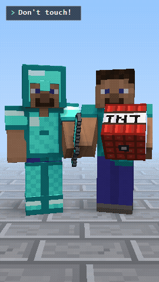
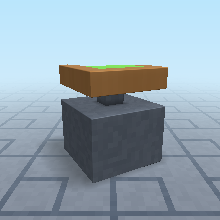
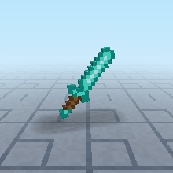

# minecraft-style-video

[English](../../README.md) · [简体中文](../../README.zh-CN.md) · [繁體中文](README.zh-TW.md) · [日本語](README.ja.md) · [한국어](README.ko.md) · [Español](README.es.md) · **Français** · [Deutsch](README.de.md) · [Português](README.pt-BR.md) · [Русский](README.ru.md)

Générez des vidéos courtes verticales 9:16 de personnages, créatures et blocs style Minecraft avec une géométrie voxel `8x8x8` et `16x16x16` verrouillée et des prompts adaptés à chaque modèle.

Les prompts génériques du type « personnage Minecraft qui mine du diamant » produisent souvent cinq doigts humains, des textures floues façon pâte à modeler, des pioches cylindriques lisses ou des têtes arrondies style Roblox avec pinces Lego. `minecraft-style-video` fixe l'anatomie voxel avant l'animation : tête cubique `8x8x8` avec surcouche 3D `+0.5px`, torse `8x12x4`, bras `4x12x4` (Steve) ou `3x12x4` (Alex) à extrémité carrée plate, blocs `16x16x16` sans filtrage flou, coffres articulés `14x14x14` et outils extrudés `16x16x1`.


## Démarrage rapide

Clonez le dépôt dans votre dossier local de Skills (compatible avec Claude Code, Codex, Cursor et GitHub Copilot) :

```bash
git clone https://github.com/yuzhang-zhong/minecraft-style-video.git ~/.codex/skills/minecraft-style-video
```

Les quatre scripts CLI fonctionnent avec la bibliothèque standard de Node.js 18+ ; `ffmpeg` n'est requis que pour régénérer localement les aperçus `.gif` et `.mp4`.

```text
Utilise $minecraft-style-video pour planifier un court métrage isométrique 9:16 de 15 secondes où Alex
pose un établi, un coffre et une lanterne lumineuse sur une cabane en blocs d'herbe près d'un axolotl rose, avec 4 plans Kling I2V.
```

## Aperçu visuel et 6 exemples de vidéos courtes

| Référence 3 vues (`0° / 45° / 90°`) | Contrôle anti-dérive (`× Drift` vs. `✓ Locked`) |
| :---: | :---: |
|  |  |

| 01 · Diamant & Creeper (`Kling`) | 02 · Cabane & Lanterne (`Seedance`) | 03 · Pro vs. Noob TNT (`Hailuo`) |
| :---: | :---: | :---: |
|  |  |  |
| [Planche](../../examples/diamond-creeper-ambush/assets/storyboard_contact_sheet.en.png) · [MP4](../../examples/diamond-creeper-ambush/assets/diamond_creeper_ambush.mp4) · [Pack](../../examples/diamond-creeper-ambush/) | [Planche](../../examples/cozy-lantern-build/assets/cozy_storyboard_sheet.en.png) · [MP4](../../examples/cozy-lantern-build/assets/cozy_lantern_build.mp4) · [Pack](../../examples/cozy-lantern-build/) | [Planche](../../examples/pro-builder-vs-noob-tnt/assets/tnt_storyboard_sheet.en.png) · [MP4](../../examples/pro-builder-vs-noob-tnt/assets/pro_builder_vs_noob_tnt.mp4) · [Pack](../../examples/pro-builder-vs-noob-tnt/) |
| **04 · Chaîne de Pistons (`Wan`)** | **05 · Enderman & Bloc d'Herbe (`Sora`)** | **06 · Axolotl sous la Pluie (`Runway`)** |
|  |  |  |
| [Planche](../../examples/redstone-chain-asmr/assets/redstone_storyboard_sheet.en.png) · [MP4](../../examples/redstone-chain-asmr/assets/redstone_chain_asmr.mp4) · [Pack](../../examples/redstone-chain-asmr/) | [Planche](../../examples/enderman-block-heist/assets/enderman_storyboard_sheet.en.png) · [MP4](../../examples/enderman-block-heist/assets/enderman_block_heist.mp4) · [Pack](../../examples/enderman-block-heist/) | [Planche](../../examples/axolotl-rainy-shelter/assets/axolotl_storyboard_sheet.en.png) · [MP4](../../examples/axolotl-rainy-shelter/assets/axolotl_rainy_shelter.mp4) · [Pack](../../examples/axolotl-rainy-shelter/) |

## Bibliothèque classique de personnages et blocs

Pré-rendue dans [`assets/library/catalog.json`](../../assets/library/catalog.json) et documentée dans [`references/classic-minecraft-catalog.md`](../../references/classic-minecraft-catalog.md) :

| Classic Steve | Slim Alex | Diamond Knight | Cozy Hoodie | Creeper | Enderman |
| :---: | :---: | :---: | :---: | :---: | :---: |
|  |  |  |  |  |  |

| Grass Block | Diamond Ore | TNT Block | Crafting Table | Hinged Chest | Sticky Piston | Pickaxe | Sword |
| :---: | :---: | :---: | :---: | :---: | :---: | :---: | :---: |
|  |  |  |  |  |  |  |  |

## Outils CLI et limites

- [`scripts/voxel_spec.mjs`](../../scripts/voxel_spec.mjs) : génère une fiche ADN personnage/créature/bloc et des prompts 3 vues ou isométriques.
- [`scripts/shot_compiler.mjs`](../../scripts/shot_compiler.mjs) : compile des storyboards 9:16 pour `kling`, `seedance`, `hailuo`, `wan`, `sora` et `runway`.
- [`scripts/drift_check.mjs`](../../scripts/drift_check.mjs) : détecte doigts humains, outils cylindriques, flou bilinéaire et surcharge d'actions.
- [`scripts/render_preview.mjs`](../../scripts/render_preview.mjs) : effectue le rendu 3D local des planches, miniatures et aperçus `.gif` / `.mp4`.

```bash
node scripts/voxel_spec.mjs --archetype steve-miner --object diamond-ore --held-item diamond-pickaxe --lang fr
node scripts/shot_compiler.mjs --template diamond-creeper-ambush --duration 15 --engine kling --lang fr
```

Les fichiers `.gif` et `.mp4` fournis sont des aperçus 3D locaux déterministes ; le rendu vidéo final nécessite un modèle externe. Limitez chaque plan de 4 à 5 secondes à une seule action principale. Licence MIT ([LICENSE](../../LICENSE)), projet indépendant non affilié à Mojang Studios ni à Microsoft. Voir [`SKILL.md`](../../SKILL.md).
