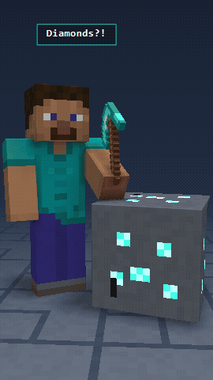
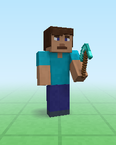
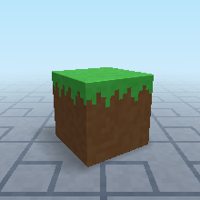
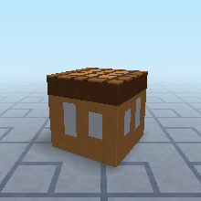

# minecraft-style-video

[English](../../README.md) · [简体中文](../../README.zh-CN.md) · [繁體中文](README.zh-TW.md) · **日本語** · [한국어](README.ko.md) · [Español](README.es.md) · [Français](README.fr.md) · [Deutsch](README.de.md) · [Português](README.pt-BR.md) · [Русский](README.ru.md)

Minecraft 風の `8x8x8` キャラと `16x16x16` ブロックのピクセル比率を固定し、9:16 縦型ショート動画の絵コンテ・三面図・モデル別プロンプトを生成するスキルです。

動画生成 AI に「マイクラのキャラがダイヤを掘る」とだけ指示すると、人間の5本指、ぼやけた粘土状テクスチャ、丸い金属のツルハシ、Roblox 風の円筒ヘッドやレゴの爪に崩れがちです。`minecraft-style-video` はアニメーション前に標準ボクセル構造（`8x8x8` の立方体ヘッドと `+0.5px` 外層スキン、`8x12x4` の胴体、`4x4`/`3x4` 角柱の手先、`16x16x16` ニアレストネイバー・ブロック、`14x14x14` 開閉チェスト、`16x16x1` 押し出しピクセルツール）を固定します。


## クイックスタート

ローカルの Skills ディレクトリにクローンします（Claude Code、Codex、Cursor、GitHub Copilot 対応）：

```bash
git clone https://github.com/yuzhang-zhong/minecraft-style-video.git ~/.codex/skills/minecraft-style-video
```

4つの CLI スクリプトは Node.js 18+ 標準ライブラリのみで動作します（`.gif` / `.mp4` の再生成時のみ `ffmpeg` が必要です）。

```text
$minecraft-style-video を使って、Alex が草ブロックの小屋に作業台・チェスト・ランタンを置き、
ピンクのウーパールーパーと過ごす15秒の 9:16 ショート動画を企画して。Kling I2V 用の4カット絵コンテを出して。
```

## プレビュー & 6つのショート動画パッケージ

| 3面図リファレンス (`0° / 45° / 90°`) | 形状崩れチェック (`× Drift` vs. `✓ Locked`) |
| :---: | :---: |
|  |  |

| 01 · ダイヤとクリーパー (`Kling`) | 02 · ランタン建築 (`Seedance`) | 03 · ダイヤ装備 vs TNT (`Hailuo`) |
| :---: | :---: | :---: |
|  |  |  |
| [絵コンテ](../../examples/diamond-creeper-ambush/assets/storyboard_contact_sheet.en.png) · [MP4](../../examples/diamond-creeper-ambush/assets/diamond_creeper_ambush.mp4) · [構成](../../examples/diamond-creeper-ambush/) | [絵コンテ](../../examples/cozy-lantern-build/assets/cozy_storyboard_sheet.en.png) · [MP4](../../examples/cozy-lantern-build/assets/cozy_lantern_build.mp4) · [構成](../../examples/cozy-lantern-build/) | [絵コンテ](../../examples/pro-builder-vs-noob-tnt/assets/tnt_storyboard_sheet.en.png) · [MP4](../../examples/pro-builder-vs-noob-tnt/assets/pro_builder_vs_noob_tnt.mp4) · [構成](../../examples/pro-builder-vs-noob-tnt/) |
| **04 · レッドストーン連鎖 (`Wan`)** | **05 · エンダーマンの草泥棒 (`Sora`)** | **06 · 雨夜のウーパールーパー (`Runway`)** |
|  |  |  |
| [絵コンテ](../../examples/redstone-chain-asmr/assets/redstone_storyboard_sheet.en.png) · [MP4](../../examples/redstone-chain-asmr/assets/redstone_chain_asmr.mp4) · [構成](../../examples/redstone-chain-asmr/) | [絵コンテ](../../examples/enderman-block-heist/assets/enderman_storyboard_sheet.en.png) · [MP4](../../examples/enderman-block-heist/assets/enderman_block_heist.mp4) · [構成](../../examples/enderman-block-heist/) | [絵コンテ](../../examples/axolotl-rainy-shelter/assets/axolotl_storyboard_sheet.en.png) · [MP4](../../examples/axolotl-rainy-shelter/assets/axolotl_rainy_shelter.mp4) · [構成](../../examples/axolotl-rainy-shelter/) |

## 定番 Minecraft アセットライブラリ

[`assets/library/catalog.json`](../../assets/library/catalog.json) と [`references/classic-minecraft-catalog.md`](../../references/classic-minecraft-catalog.md) に収録：

| Classic Steve | Slim Alex | Diamond Knight | Cozy Hoodie | Creeper | Enderman |
| :---: | :---: | :---: | :---: | :---: | :---: |
|  |  |  |  |  |  |

| Grass Block | Diamond Ore | TNT Block | Crafting Table | Hinged Chest | Sticky Piston | Pickaxe | Sword |
| :---: | :---: | :---: | :---: | :---: | :---: | :---: | :---: |
|  |  |  |  |  |  |  |  |

## CLI ツールと前提条件

- [`scripts/voxel_spec.mjs`](../../scripts/voxel_spec.mjs)：キャラ・モブ・ブロックの DNA カードと三面図/アイソメトリックプロンプトを生成。
- [`scripts/shot_compiler.mjs`](../../scripts/shot_compiler.mjs)：9:16 絵コンテと `kling`、`seedance`、`hailuo`、`wan`、`sora`、`runway` 向けプロンプトを出力。
- [`scripts/drift_check.mjs`](../../scripts/drift_check.mjs)：5本指・丸棒ツール・テクスチャぼけ・動作過多を検査し、修正版を出力。
- [`scripts/render_preview.mjs`](../../scripts/render_preview.mjs)：ローカル 3D ボクセル三面図、絵コンテシート、`.gif` / `.mp4` プレビューを描画。

```bash
node scripts/voxel_spec.mjs --archetype steve-miner --object diamond-ore --held-item diamond-pickaxe --lang ja
node scripts/shot_compiler.mjs --template diamond-creeper-ambush --duration 15 --engine kling --lang ja
```

同梱の `.gif` / `.mp4` はローカル 3D プレビューであり、実際の動画生成には外部モデルを使用します。4〜5秒につき主要アクションは1つに絞ってください。MIT ライセンス（[LICENSE](../../LICENSE)）。Mojang Studios および Microsoft とは無関係です。詳細は [`SKILL.md`](../../SKILL.md) を参照してください。
