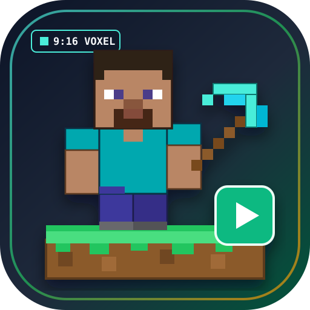

<div align="center">



# Minecraft Style Video

9:16 Minecraft ボクセルショート動画を設計：`8x8x8` キャラと `16x16x16` ブロック比率を固定し、カット別プロンプトとローカル 3D 動画プレビューを生成します。

[](../../skills/minecraft-style-video/SKILL.md)
[](#クイックスタート)
[](../../LICENSE)

**[アニメーション例](#アニメーション例)** · [ブロック＆アイテム動線](#ブロックとアイテムのループ動画) · [クイックスタート](#クイックスタート) · [Skill ガイド](../../skills/minecraft-style-video/SKILL.md)

[English](../../README.md) · [简体中文](../../README.zh-CN.md) · [繁體中文](README.zh-TW.md) · **日本語** · [한국어](README.ko.md) · [Español](README.es.md) · [Français](README.fr.md) · [Deutsch](README.de.md) · [Português](README.pt-BR.md) · [Русский](README.ru.md)

</div>

[](../../assets/showcase/minecraft_shorts_reel.mp4)

## アニメーション例

各パッケージは 15 秒・4 カットの縦型ショート動画を構成します。以下の **4 秒 GIF / MP4** は構図とボクセル比率を確認するためのローカル 3D プレビューです。クリックすると音声付き MP4 が開きます。本番生成は対応する外部動画モデルで実行してください。

| 01 · ダイヤとクリーパー (`Kling`) | 02 · ランタン建築 (`Seedance`) | 03 · ダイヤ装備 vs TNT (`Hailuo`) |
| :---: | :---: | :---: |
| [](../../examples/diamond-creeper-ambush/assets/diamond_creeper_ambush.mp4) | [](../../examples/cozy-lantern-build/assets/cozy_lantern_build.mp4) | [](../../examples/pro-builder-vs-noob-tnt/assets/pro_builder_vs_noob_tnt.mp4) |
| [MP4](../../examples/diamond-creeper-ambush/assets/diamond_creeper_ambush.mp4) · [絵コンテ](../../examples/diamond-creeper-ambush/assets/storyboard_contact_sheet.en.png) · [プロンプト](../../examples/diamond-creeper-ambush/) | [MP4](../../examples/cozy-lantern-build/assets/cozy_lantern_build.mp4) · [絵コンテ](../../examples/cozy-lantern-build/assets/cozy_storyboard_sheet.en.png) · [プロンプト](../../examples/cozy-lantern-build/) | [MP4](../../examples/pro-builder-vs-noob-tnt/assets/pro_builder_vs_noob_tnt.mp4) · [絵コンテ](../../examples/pro-builder-vs-noob-tnt/assets/tnt_storyboard_sheet.en.png) · [プロンプト](../../examples/pro-builder-vs-noob-tnt/) |
| **04 · レッドストーン連鎖 (`Wan`)** | **05 · エンダーマンの草泥棒 (`Sora`)** | **06 · 雨夜のウーパールーパー (`Runway`)** |
| [](../../examples/redstone-chain-asmr/assets/redstone_chain_asmr.mp4) | [](../../examples/enderman-block-heist/assets/enderman_block_heist.mp4) | [](../../examples/axolotl-rainy-shelter/assets/axolotl_rainy_shelter.mp4) |
| [MP4](../../examples/redstone-chain-asmr/assets/redstone_chain_asmr.mp4) · [絵コンテ](../../examples/redstone-chain-asmr/assets/redstone_storyboard_sheet.en.png) · [プロンプト](../../examples/redstone-chain-asmr/) | [MP4](../../examples/enderman-block-heist/assets/enderman_block_heist.mp4) · [絵コンテ](../../examples/enderman-block-heist/assets/enderman_storyboard_sheet.en.png) · [プロンプト](../../examples/enderman-block-heist/) | [MP4](../../examples/axolotl-rainy-shelter/assets/axolotl_rainy_shelter.mp4) · [絵コンテ](../../examples/axolotl-rainy-shelter/assets/axolotl_storyboard_sheet.en.png) · [プロンプト](../../examples/axolotl-rainy-shelter/) |

## ブロックとアイテムのループ動画

オブジェクト単体のカット（チェスト開封、レッドストーン機構、TNT 起爆）でも、丸棒化やテクスチャのぼけを防ぎ `16x16x1` 押し出しピクセル形状を維持します：

| 開閉チェスト & `16x16x1` ツール | 吸着ピストン & レッドストーンランプ | 点火 `TNT` & ボクセル煙 |
| :---: | :---: | :---: |
| [](../../assets/showcase/chest_loot_loop.mp4) | [](../../assets/showcase/piston_ore_loop.mp4) | [](../../assets/showcase/tnt_blast_loop.mp4) |
| `14x14x14` チェスト + ダイヤツール（[MP4](../../assets/showcase/chest_loot_loop.mp4)） | `16x16x16` ピストン + 発光ダイヤ鉱石（[MP4](../../assets/showcase/piston_ore_loop.mp4)） | 白点滅膨張 + 角ブロック煙（[MP4](../../assets/showcase/tnt_blast_loop.mp4)） |

## クイックスタート

ローカルの Skills ディレクトリにクローンします（Codex、GitHub Copilot、Claude Code、Cursor 対応）：

```bash
git clone https://github.com/yuzhang-zhong/minecraft-style-video.git ~/.codex/skills/minecraft-style-video
```

Node.js 18+ 標準ライブラリのみで CLI を直接実行できます：

```bash
node scripts/voxel_spec.mjs --archetype steve-miner --object diamond-ore --held-item diamond-pickaxe --lang ja
node scripts/shot_compiler.mjs --template diamond-creeper-ambush --duration 15 --engine kling --lang ja
node scripts/drift_check.mjs --prompt "A cute Minecraft boy holding a round metal sword with five fingers mines ore and runs away" --engine kling --mode t2v --lang ja
```

## スクリプト・制約・リファレンス

マルチショット I2V では先に[三面図リファレンス](../../assets/showcase/steve_alex_turnaround_sheet.en.png)で開始フレームを固定し、4〜5秒につき主要アクションを1つに絞ってください（[崩れ比較ボード](../../assets/showcase/drift_rescue_comparison.en.png) · [ワークフロー図](../pipeline.svg)）。

- [`voxel_spec.mjs`](../../scripts/voxel_spec.mjs) · [`shot_compiler.mjs`](../../scripts/shot_compiler.mjs) · [`drift_check.mjs`](../../scripts/drift_check.mjs) · [`render_preview.mjs`](../../scripts/render_preview.mjs)
- [Skill ガイド (`SKILL.md`)](../../skills/minecraft-style-video/SKILL.md) · [ボクセル比率＆ブロック仕様](../../references/voxel-geometry-blocks-and-shaders.md) · [モデル別プロンプト](../../references/model-prompt-playbook.md) · [破綻修正パッチ](../../references/rescue-and-anti-drift.md) · [テンポ＆効果音](../../references/short-video-beats-and-audio.md) · [テンプレート集](../../references/viral-archetypes-catalog.md)

[MIT License](../../LICENSE)。独立したオープンソースプロジェクトであり、Mojang Studios および Microsoft とは無関係です。
