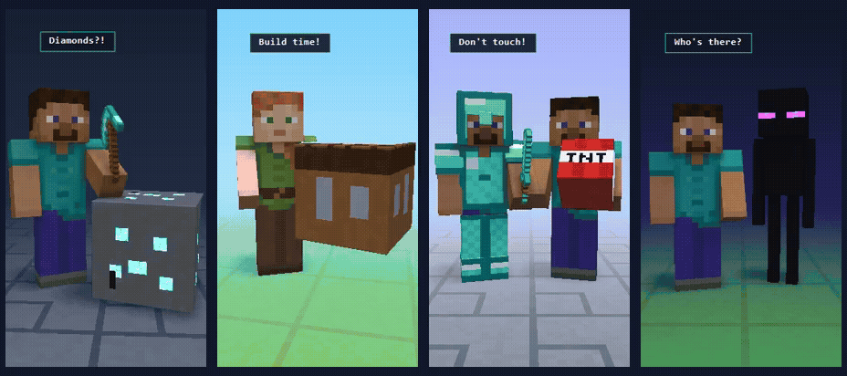
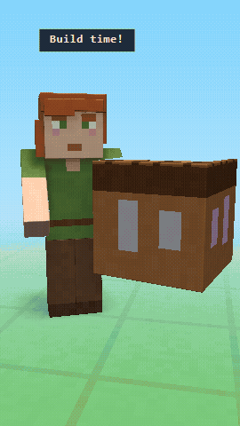

<div align="center">


# Minecraft Style Video

9:16 마인크래프트 복셀 쇼츠 기획: `8x8x8` 캐릭터와 `16x16x16` 블록 비율을 고정하고 컷별 프롬프트와 로컬 3D 모션 프리뷰를 생성합니다.

[](../../SKILL.md)
[](#빠른-시작)
[](../../LICENSE)

**[애니메이션 예제](#애니메이션-예제)** · [블록 & 아이템 루프](#복셀-블록-및-아이템-루프) · [빠른 시작](#빠른-시작) · [Skill 가이드](../../SKILL.md)

[English](../../README.md) · [简体中文](../../README.zh-CN.md) · [繁體中文](README.zh-TW.md) · [日本語](README.ja.md) · **한국어** · [Español](README.es.md) · [Français](README.fr.md) · [Deutsch](README.de.md) · [Português](README.pt-BR.md) · [Русский](README.ru.md)

</div>

[](../../assets/showcase/minecraft_shorts_reel.mp4)

## 애니메이션 예제

각 패키지는 15초·4컷 세로형 쇼츠를 설계합니다. 아래의 **4초 GIF와 MP4**는 구도와 픽셀 비율을 점검하기 위한 로컬 3D 프리뷰이며, 클릭하면 오디오가 포함된 MP4가 열립니다. 최종 영상은 외부 비디오 모델에서 생성합니다.

| 01 · 다이아와 크리퍼 (`Kling`) | 02 · 아늑한 랜턴 건축 (`Seedance`) | 03 · 다이아 고수 vs 뉴비 TNT (`Hailuo`) |
| :---: | :---: | :---: |
| [](../../examples/diamond-creeper-ambush/assets/diamond_creeper_ambush.mp4) | [](../../examples/cozy-lantern-build/assets/cozy_lantern_build.mp4) | [](../../examples/pro-builder-vs-noob-tnt/assets/pro_builder_vs_noob_tnt.mp4) |
| [MP4](../../examples/diamond-creeper-ambush/assets/diamond_creeper_ambush.mp4) · [스토리보드](../../examples/diamond-creeper-ambush/assets/storyboard_contact_sheet.en.png) · [프롬프트](../../examples/diamond-creeper-ambush/) | [MP4](../../examples/cozy-lantern-build/assets/cozy_lantern_build.mp4) · [스토리보드](../../examples/cozy-lantern-build/assets/cozy_storyboard_sheet.en.png) · [프롬프트](../../examples/cozy-lantern-build/) | [MP4](../../examples/pro-builder-vs-noob-tnt/assets/pro_builder_vs_noob_tnt.mp4) · [스토리보드](../../examples/pro-builder-vs-noob-tnt/assets/tnt_storyboard_sheet.en.png) · [프롬프트](../../examples/pro-builder-vs-noob-tnt/) |
| **04 · 레드스톤 피스톤 연쇄 (`Wan`)** | **05 · 엔더맨의 잔디 블록 도둑 (`Sora`)** | **06 · 빗속의 분홍 아홀로틀 (`Runway`)** |
| [](../../examples/redstone-chain-asmr/assets/redstone_chain_asmr.mp4) | [](../../examples/enderman-block-heist/assets/enderman_block_heist.mp4) | [](../../examples/axolotl-rainy-shelter/assets/axolotl_rainy_shelter.mp4) |
| [MP4](../../examples/redstone-chain-asmr/assets/redstone_chain_asmr.mp4) · [스토리보드](../../examples/redstone-chain-asmr/assets/redstone_storyboard_sheet.en.png) · [프롬프트](../../examples/redstone-chain-asmr/) | [MP4](../../examples/enderman-block-heist/assets/enderman_block_heist.mp4) · [스토리보드](../../examples/enderman-block-heist/assets/enderman_storyboard_sheet.en.png) · [프롬프트](../../examples/enderman-block-heist/) | [MP4](../../examples/axolotl-rainy-shelter/assets/axolotl_rainy_shelter.mp4) · [스토리보드](../../examples/axolotl-rainy-shelter/assets/axolotl_storyboard_sheet.en.png) · [프롬프트](../../examples/axolotl-rainy-shelter/) |

## 복셀 블록 및 아이템 루프

오브젝트 단독 컷(상자 오픈, 레드스톤 장치, TNT 폭발)에서도 모서리 뭉개짐 없이 `16x16x1` 계단식 픽셀 도구와 블록 경첩을 유지합니다:

| 경첩 상자 & `16x16x1` 도구 | 끈끈이 피스톤 & 레드스톤 조명 | 점화 `TNT` & 복셀 연기 |
| :---: | :---: | :---: |
| [](../../assets/showcase/chest_loot_loop.mp4) | [](../../assets/showcase/piston_ore_loop.mp4) | [](../../assets/showcase/tnt_blast_loop.mp4) |
| `14x14x14` 상자 + 다이아 도구 ([MP4](../../assets/showcase/chest_loot_loop.mp4)) | `16x16x16` 피스톤 + 발광 다이아 원석 ([MP4](../../assets/showcase/piston_ore_loop.mp4)) | 백색 점멸 팽창 + 정육면체 연기 ([MP4](../../assets/showcase/tnt_blast_loop.mp4)) |

## 빠른 시작

로컬 Skills 폴더에 클론합니다 (Codex, GitHub Copilot, Claude Code, Cursor 지원):

```bash
git clone https://github.com/yuzhang-zhong/minecraft-style-video.git ~/.codex/skills/minecraft-style-video
```

Node.js 18+ 표준 라이브러리만으로 CLI를 바로 실행할 수 있습니다:

```bash
node scripts/voxel_spec.mjs --archetype steve-miner --object diamond-ore --held-item diamond-pickaxe --lang ko
node scripts/shot_compiler.mjs --template diamond-creeper-ambush --duration 15 --engine kling --lang ko
node scripts/drift_check.mjs --prompt "A cute Minecraft boy holding a round metal sword with five fingers mines ore and runs away" --engine kling --mode t2v --lang ko
```

## 스크립트, 제한 사항 및 참고 문서

멀티샷 I2V 제작 시 [3면도 레퍼런스](../../assets/showcase/steve_alex_turnaround_sheet.en.png)로 첫 프레임을 고정하고 4~5초 클립당 핵심 동작을 하나로 제한하세요 ([왜곡 비교 보드](../../assets/showcase/drift_rescue_comparison.en.png) · [워크플로 다이어그램](../pipeline.svg)).

- [`voxel_spec.mjs`](../../scripts/voxel_spec.mjs) · [`shot_compiler.mjs`](../../scripts/shot_compiler.mjs) · [`drift_check.mjs`](../../scripts/drift_check.mjs) · [`render_preview.mjs`](../../scripts/render_preview.mjs)
- [Skill 가이드 (`SKILL.md`)](../../SKILL.md) · [복셀 비율 & 블록 규격](../../references/voxel-geometry-blocks-and-shaders.md) · [모델별 프롬프트](../../references/model-prompt-playbook.md) · [왜곡 수정 패치](../../references/rescue-and-anti-drift.md) · [템포 & 효과음](../../references/short-video-beats-and-audio.md) · [스토리 템플릿](../../references/viral-archetypes-catalog.md)

[MIT License](../../LICENSE). Mojang Studios 및 Microsoft와 무관한 독립 오픈소스 프로젝트입니다.
