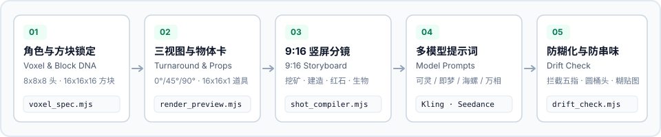
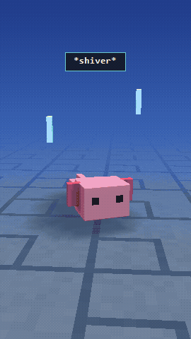
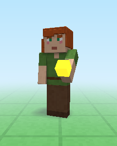
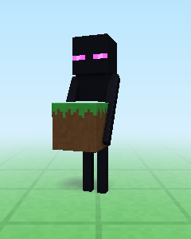

# minecraft-style-video

[English](../../README.md) · [简体中文](../../README.zh-CN.md) · [繁體中文](README.zh-TW.md) · [日本語](README.ja.md) · **한국어** · [Español](README.es.md) · [Français](README.fr.md) · [Deutsch](README.de.md) · [Português](README.pt-BR.md) · [Русский](README.ru.md)

Minecraft 스타일의 `8x8x8` 캐릭터·몹과 `16x16x16` 블록 픽셀 비율을 고정해 9:16 세로형 쇼츠 스토리보드와 모델별 프롬프트를 생성하는 스킬입니다.

비디오 생성 모델에 막연히 "마크 캐릭터가 다이아를 캔다"라고 입력하면 다섯 손가락, 흐릿하게 뭉개진 텍스처, 둥근 금속 곡괭이, 또는 Roblox 원통형 머리와 레고 집게손으로 왜곡되기 쉽습니다. `minecraft-style-video`는 모션 작성 전에 정통 복셀 규격(`8x8x8` 정육면체 머리 + `+0.5px` 3D 외피 레이어, `8x12x4` 몸통, `4x4`/`3x4` 평면 사각 손끝, `16x16x16` 최근접 픽셀 블록, `14x14x14` 경첩 상자, `16x16x1` 계단식 픽셀 도구)을 고정합니다.



## 빠른 시작

로컬 Skills 폴더에 저장소를 클론합니다 (Claude Code, Codex, Cursor, GitHub Copilot 지원):

```bash
git clone https://github.com/yuzhang-zhong/minecraft-style-video.git ~/.codex/skills/minecraft-style-video
```

네 개의 CLI 스크립트는 Node.js 18+ 표준 라이브러리만으로 실행되며, 로컬 `.gif` / `.mp4` 재렌더링 시에만 `ffmpeg`가 필요합니다.

```text
$minecraft-style-video 를 사용해 Alex가 잔디 블록 오두막에 제작대, 상자, 랜턴을 놓고
분홍 아홀로틀과 쉬는 15초 9:16 쇼츠를 기획해 줘. Kling I2V용 4컷 스토리보드와 프롬프트를 작성해 줘.
```

## 프리뷰 & 6종 쇼츠 예제

| 3면도 레퍼런스 (`0° / 45° / 90°`) | 왜곡 방지 비교 (`× Drift` vs. `✓ Locked`) |
| :---: | :---: |
|  |  |

| 01 · 다이아와 크리퍼 (`Kling`) | 02 · 아늑한 랜턴 건축 (`Seedance`) | 03 · 다이아 고수 vs 뉴비 TNT (`Hailuo`) |
| :---: | :---: | :---: |
|  |  |  |
| [시트](../../examples/diamond-creeper-ambush/assets/storyboard_contact_sheet.en.png) · [MP4](../../examples/diamond-creeper-ambush/assets/diamond_creeper_ambush.mp4) · [폴더](../../examples/diamond-creeper-ambush/) | [시트](../../examples/cozy-lantern-build/assets/cozy_storyboard_sheet.en.png) · [MP4](../../examples/cozy-lantern-build/assets/cozy_lantern_build.mp4) · [폴더](../../examples/cozy-lantern-build/) | [시트](../../examples/pro-builder-vs-noob-tnt/assets/tnt_storyboard_sheet.en.png) · [MP4](../../examples/pro-builder-vs-noob-tnt/assets/pro_builder_vs_noob_tnt.mp4) · [폴더](../../examples/pro-builder-vs-noob-tnt/) |
| **04 · 레드스톤 피스톤 연쇄 (`Wan`)** | **05 · 엔더맨의 잔디 블록 도둑 (`Sora`)** | **06 · 빗속의 분홍 아홀로틀 (`Runway`)** |
|  |  |  |
| [시트](../../examples/redstone-chain-asmr/assets/redstone_storyboard_sheet.en.png) · [MP4](../../examples/redstone-chain-asmr/assets/redstone_chain_asmr.mp4) · [폴더](../../examples/redstone-chain-asmr/) | [시트](../../examples/enderman-block-heist/assets/enderman_storyboard_sheet.en.png) · [MP4](../../examples/enderman-block-heist/assets/enderman_block_heist.mp4) · [폴더](../../examples/enderman-block-heist/) | [시트](../../examples/axolotl-rainy-shelter/assets/axolotl_storyboard_sheet.en.png) · [MP4](../../examples/axolotl-rainy-shelter/assets/axolotl_rainy_shelter.mp4) · [폴더](../../examples/axolotl-rainy-shelter/) |

## 클래식 Minecraft 에셋 라이브러리

[`assets/library/catalog.json`](../../assets/library/catalog.json) 및 [`references/classic-minecraft-catalog.md`](../../references/classic-minecraft-catalog.md)에 수록되어 있습니다:

| Classic Steve | Slim Alex | Diamond Knight | Cozy Hoodie | Creeper | Enderman |
| :---: | :---: | :---: | :---: | :---: | :---: |
|  |  |  |  |  |  |

| Grass Block | Diamond Ore | TNT Block | Crafting Table | Hinged Chest | Sticky Piston | Pickaxe | Sword |
| :---: | :---: | :---: | :---: | :---: | :---: | :---: | :---: |
|  |  |  |  |  |  |  |  |

## CLI 도구 및 범위 안내

- [`scripts/voxel_spec.mjs`](../../scripts/voxel_spec.mjs): 캐릭터·몹·블록 DNA 카드 및 3면도/아이소메트릭 프롬프트 생성.
- [`scripts/shot_compiler.mjs`](../../scripts/shot_compiler.mjs): `kling`, `seedance`, `hailuo`, `wan`, `sora`, `runway` 맞춤 9:16 스토리보드 컴파일.
- [`scripts/drift_check.mjs`](../../scripts/drift_check.mjs): 다섯 손가락, 둥근 도구, 텍스처 흐림, 동작 과부하 점검 및 수정 프롬프트 출력.
- [`scripts/render_preview.mjs`](../../scripts/render_preview.mjs): 로컬 3D 복셀 3면도, 스토리보드 시트, `.gif` / `.mp4` 프리뷰 렌더링.

```bash
node scripts/voxel_spec.mjs --archetype steve-miner --object diamond-ore --held-item diamond-pickaxe --lang ko
node scripts/shot_compiler.mjs --template diamond-creeper-ambush --duration 15 --engine kling --lang ko
```

저장소의 `.gif` / `.mp4`는 로컬 3D 복셀 프리뷰이며 실제 확산 영상은 외부 비디오 모델에서 생성합니다. 4~5초 클립당 핵심 동작은 하나만 배치하세요. MIT 라이선스([LICENSE](../../LICENSE)), Mojang Studios 및 Microsoft와 무관한 독립 오픈소스 프로젝트입니다. 자세한 내용은 [`SKILL.md`](../../SKILL.md)를 참고하세요.
