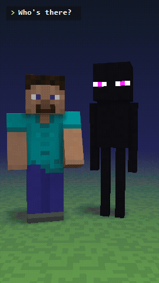

<div align="center">


# Minecraft Style Video

Планируйте вертикальные 9:16 ролики в стиле Minecraft: фиксируйте воксельные пропорции `8x8x8` и `16x16x16`, компилируйте промпты по планам и проверяйте движение локально.

[](../../skills/minecraft-style-video/SKILL.md)
[](#быстрый-старт)
[](../../LICENSE)

**[Анимированные примеры](#анимированные-примеры)** · [Циклы блоков](#анимации-блоков-и-предметов) · [Быстрый старт](#быстрый-старт) · [Руководство Skill](../../skills/minecraft-style-video/SKILL.md)

[English](../../README.md) · [简体中文](../../README.zh-CN.md) · [繁體中文](README.zh-TW.md) · [日本語](README.ja.md) · [한국어](README.ko.md) · [Español](README.es.md) · [Français](README.fr.md) · [Deutsch](README.de.md) · [Português](README.pt-BR.md) · **Русский**

</div>

[](../../assets/showcase/minecraft_shorts_reel.mp4)

## Анимированные примеры

Каждый пакет рассчитан на 15-секундный вертикальный ролик из четырёх планов. **4-секундные GIF и MP4** ниже — локальные 3D-превью для проверки кадрирования и воксельных пропорций; нажмите на любую анимацию, чтобы открыть MP4 со звуком. Финальное видео генерируется во внешней модели.

| 01 · Алмаз и Крипер (`Kling`) | 02 · Домик с Фонарём (`Seedance`) | 03 · Профи vs. Нуб с TNT (`Hailuo`) |
| :---: | :---: | :---: |
| [](../../examples/diamond-creeper-ambush/assets/diamond_creeper_ambush.mp4) | [](../../examples/cozy-lantern-build/assets/cozy_lantern_build.mp4) | [](../../examples/pro-builder-vs-noob-tnt/assets/pro_builder_vs_noob_tnt.mp4) |
| [MP4](../../examples/diamond-creeper-ambush/assets/diamond_creeper_ambush.mp4) · [Раскадровка](../../examples/diamond-creeper-ambush/assets/storyboard_contact_sheet.en.png) · [Промпты](../../examples/diamond-creeper-ambush/) | [MP4](../../examples/cozy-lantern-build/assets/cozy_lantern_build.mp4) · [Раскадровка](../../examples/cozy-lantern-build/assets/cozy_storyboard_sheet.en.png) · [Промпты](../../examples/cozy-lantern-build/) | [MP4](../../examples/pro-builder-vs-noob-tnt/assets/pro_builder_vs_noob_tnt.mp4) · [Раскадровка](../../examples/pro-builder-vs-noob-tnt/assets/tnt_storyboard_sheet.en.png) · [Промпты](../../examples/pro-builder-vs-noob-tnt/) |
| **04 · Цепь Поршней (`Wan`)** | **05 · Эндермен и Блок Травы (`Sora`)** | **06 · Аксолотль под Дождём (`Runway`)** |
| [](../../examples/redstone-chain-asmr/assets/redstone_chain_asmr.mp4) | [](../../examples/enderman-block-heist/assets/enderman_block_heist.mp4) | [](../../examples/axolotl-rainy-shelter/assets/axolotl_rainy_shelter.mp4) |
| [MP4](../../examples/redstone-chain-asmr/assets/redstone_chain_asmr.mp4) · [Раскадровка](../../examples/redstone-chain-asmr/assets/redstone_storyboard_sheet.en.png) · [Промпты](../../examples/redstone-chain-asmr/) | [MP4](../../examples/enderman-block-heist/assets/enderman_block_heist.mp4) · [Раскадровка](../../examples/enderman-block-heist/assets/enderman_storyboard_sheet.en.png) · [Промпты](../../examples/enderman-block-heist/) | [MP4](../../examples/axolotl-rainy-shelter/assets/axolotl_rainy_shelter.mp4) · [Раскадровка](../../examples/axolotl-rainy-shelter/assets/axolotl_storyboard_sheet.en.png) · [Промпты](../../examples/axolotl-rainy-shelter/) |

## Анимации блоков и предметов

Для предметных планов (сундуки, редстоун-механизмы, TNT) навык фиксирует петли крышек, светящиеся руды и ступенчатые пиксельные инструменты `16x16x1`:

| Сундук & Инструменты `16x16x1` | Липкий Поршень & Лампа | Зажжённый `TNT` & Кубический Дым |
| :---: | :---: | :---: |
| [](../../assets/showcase/chest_loot_loop.mp4) | [](../../assets/showcase/piston_ore_loop.mp4) | [](../../assets/showcase/tnt_blast_loop.mp4) |
| Сундук `14x14x14` + кирка и меч ([MP4](../../assets/showcase/chest_loot_loop.mp4)) | Поршень `16x16x16` + алмазная руда ([MP4](../../assets/showcase/piston_ore_loop.mp4)) | Белая вспышка + кубический дым ([MP4](../../assets/showcase/tnt_blast_loop.mp4)) |

## Быстрый старт

Склонируйте в локальную папку Skills (совместимо с Codex, GitHub Copilot, Claude Code и Cursor):

```bash
git clone https://github.com/yuzhang-zhong/minecraft-style-video.git ~/.codex/skills/minecraft-style-video
```

Или запустите CLI напрямую на Node.js 18+ без сторонних зависимостей:

```bash
node scripts/voxel_spec.mjs --archetype steve-miner --object diamond-ore --held-item diamond-pickaxe --lang ru
node scripts/shot_compiler.mjs --template diamond-creeper-ambush --duration 15 --engine kling --lang ru
node scripts/drift_check.mjs --prompt "A cute Minecraft boy holding a round metal sword with five fingers mines ore and runs away" --engine kling --mode t2v --lang ru
```

## Скрипты, ограничения и документация

Начинайте многоплановый I2V с [листа в трёх проекциях](../../assets/showcase/steve_alex_turnaround_sheet.en.png) и оставляйте одно основное действие на клип 4–5 секунд ([сравнение искажений](../../assets/showcase/drift_rescue_comparison.en.png) · [схема процесса](../pipeline.svg)).

- [`voxel_spec.mjs`](../../scripts/voxel_spec.mjs) · [`shot_compiler.mjs`](../../scripts/shot_compiler.mjs) · [`drift_check.mjs`](../../scripts/drift_check.mjs) · [`render_preview.mjs`](../../scripts/render_preview.mjs)
- [Руководство Skill (`SKILL.md`)](../../skills/minecraft-style-video/SKILL.md) · [Воксельная геометрия и блоки](../../references/voxel-geometry-blocks-and-shaders.md) · [Справочник промптов](../../references/model-prompt-playbook.md) · [Исправление искажений](../../references/rescue-and-anti-drift.md) · [Ритм и звук](../../references/short-video-beats-and-audio.md) · [Шаблоны сюжетов](../../references/viral-archetypes-catalog.md)

[Лицензия MIT](../../LICENSE). Независимый проект с открытым исходным кодом, не связанный с Mojang Studios или Microsoft.
