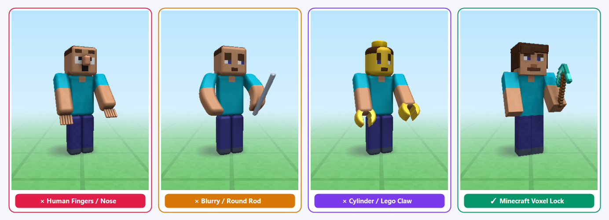
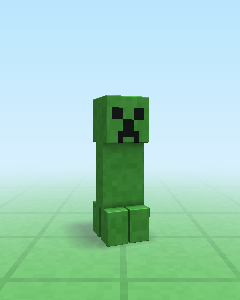
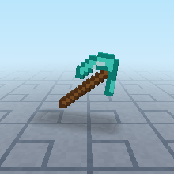

# minecraft-style-video

[English](../../README.md) · [简体中文](../../README.zh-CN.md) · [繁體中文](README.zh-TW.md) · [日本語](README.ja.md) · [한국어](README.ko.md) · [Español](README.es.md) · [Français](README.fr.md) · [Deutsch](README.de.md) · [Português](README.pt-BR.md) · **Русский**

Навык и набор CLI-инструментов для создания вертикальных 9:16 коротких видео с персонажами, мобами и блоками в стиле Minecraft с жёсткой фиксацией воксельной сетки `8x8x8` / `16x16x16` и промптами под конкретные видеомодели.

Обычные промпты вроде «персонаж Minecraft добывает алмазы» часто приводят к появлению пяти человеческих пальцев, размытых текстур, гладких круглых кирок или цилиндрических голов в стиле Roblox с клешнями Lego. `minecraft-style-video` фиксирует пропорции до анимации: кубическую голову `8x8x8` с внешним 3D-слоем `+0.5px`, торс `8x12x4`, руки `4x12x4` (Steve) или `3x12x4` (Alex) с плоскими квадратными торцами, чёткие блоки `16x16x16`, открывающиеся сундуки `14x14x14` и пиксельные инструменты `16x16x1`.


## Быстрый старт

Склонируйте репозиторий в локальную папку Skills (совместимо с Claude Code, Codex, Cursor и GitHub Copilot):

```bash
git clone https://github.com/yuzhang-zhong/minecraft-style-video.git ~/.codex/skills/minecraft-style-video
```

Все четыре CLI-скрипта используют только стандартную библиотеку Node.js 18+; `ffmpeg` нужен только для локальной пересборки `.gif` и `.mp4`.

```text
Используй $minecraft-style-video, чтобы спланировать 15-секундный изометрический ролик 9:16, где Alex
ставит верстак, сундук и светящийся фонарь у домика из блоков травы рядом с розовым аксолотлем, на 4 плана для Kling I2V.
```

## Превью и 6 примеров коротких видео

| Референс в 3 проекциях (`0° / 45° / 90°`) | Проверка геометрии (`× Drift` vs. `✓ Locked`) |
| :---: | :---: |
|  |  |

| 01 · Алмаз и Крипер (`Kling`) | 02 · Домик с Фонарём (`Seedance`) | 03 · Профи vs. Нуб с TNT (`Hailuo`) |
| :---: | :---: | :---: |
|  |  |  |
| [Лист](../../examples/diamond-creeper-ambush/assets/storyboard_contact_sheet.en.png) · [MP4](../../examples/diamond-creeper-ambush/assets/diamond_creeper_ambush.mp4) · [Папка](../../examples/diamond-creeper-ambush/) | [Лист](../../examples/cozy-lantern-build/assets/cozy_storyboard_sheet.en.png) · [MP4](../../examples/cozy-lantern-build/assets/cozy_lantern_build.mp4) · [Папка](../../examples/cozy-lantern-build/) | [Лист](../../examples/pro-builder-vs-noob-tnt/assets/tnt_storyboard_sheet.en.png) · [MP4](../../examples/pro-builder-vs-noob-tnt/assets/pro_builder_vs_noob_tnt.mp4) · [Папка](../../examples/pro-builder-vs-noob-tnt/) |
| **04 · Цепь Поршней (`Wan`)** | **05 · Эндермен и Блок Травы (`Sora`)** | **06 · Аксолотль под Дождём (`Runway`)** |
|  |  |  |
| [Лист](../../examples/redstone-chain-asmr/assets/redstone_storyboard_sheet.en.png) · [MP4](../../examples/redstone-chain-asmr/assets/redstone_chain_asmr.mp4) · [Папка](../../examples/redstone-chain-asmr/) | [Лист](../../examples/enderman-block-heist/assets/enderman_storyboard_sheet.en.png) · [MP4](../../examples/enderman-block-heist/assets/enderman_block_heist.mp4) · [Папка](../../examples/enderman-block-heist/) | [Лист](../../examples/axolotl-rainy-shelter/assets/axolotl_storyboard_sheet.en.png) · [MP4](../../examples/axolotl-rainy-shelter/assets/axolotl_rainy_shelter.mp4) · [Папка](../../examples/axolotl-rainy-shelter/) |

## Библиотека классических персонажей и блоков

Предрендерена в [`assets/library/catalog.json`](../../assets/library/catalog.json) и описана в [`references/classic-minecraft-catalog.md`](../../references/classic-minecraft-catalog.md):

| Classic Steve | Slim Alex | Diamond Knight | Cozy Hoodie | Creeper | Enderman |
| :---: | :---: | :---: | :---: | :---: | :---: |
|  |  |  |  |  |  |

| Grass Block | Diamond Ore | TNT Block | Crafting Table | Hinged Chest | Sticky Piston | Pickaxe | Sword |
| :---: | :---: | :---: | :---: | :---: | :---: | :---: | :---: |
|  |  |  |  |  |  |  |  |

## CLI-инструменты и ограничения

- [`scripts/voxel_spec.mjs`](../../scripts/voxel_spec.mjs): создаёт ДНК-карту персонажа, моба и блока с промптами в 3 проекциях и изометрии.
- [`scripts/shot_compiler.mjs`](../../scripts/shot_compiler.mjs): компилирует раскадровки 9:16 для `kling`, `seedance`, `hailuo`, `wan`, `sora` и `runway`.
- [`scripts/drift_check.mjs`](../../scripts/drift_check.mjs): проверяет промпты на человеческие пальцы, круглые инструменты, размытие пикселей и перегрузку действиями.
- [`scripts/render_preview.mjs`](../../scripts/render_preview.mjs): рендерит локальные 3D-листы, миниатюры и превью `.gif` / `.mp4`.

```bash
node scripts/voxel_spec.mjs --archetype steve-miner --object diamond-ore --held-item diamond-pickaxe --lang ru
node scripts/shot_compiler.mjs --template diamond-creeper-ambush --duration 15 --engine kling --lang ru
```

Включённые файлы `.gif` и `.mp4` являются детерминированными локальными 3D-превью; финальная генерация видео требует внешней модели. Оставляйте не более одного основного действия на клип 4–5 секунд. Лицензия MIT ([LICENSE](../../LICENSE)), независимый проект, не связанный с Mojang Studios или Microsoft. Подробнее в [`SKILL.md`](../../SKILL.md).
