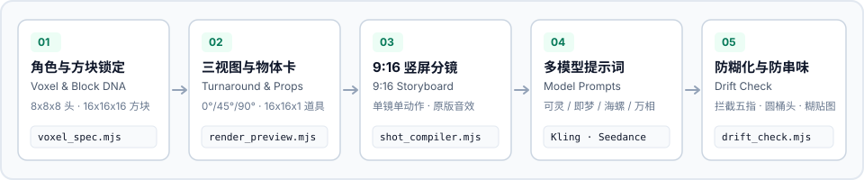
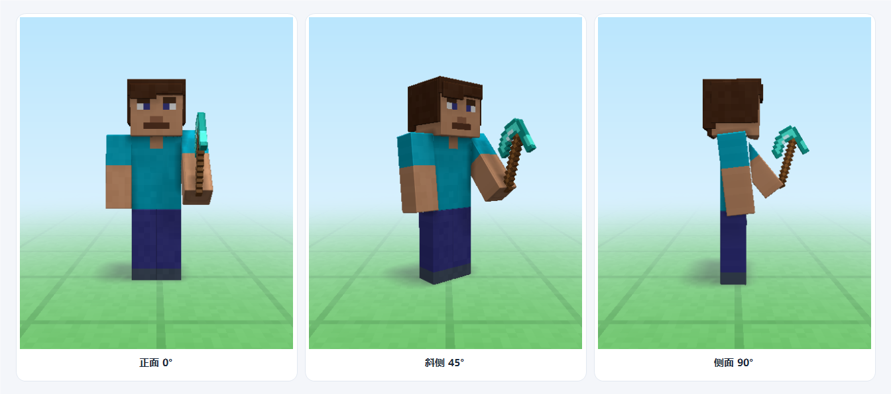
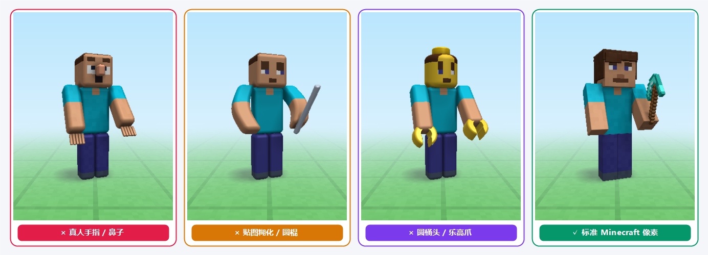
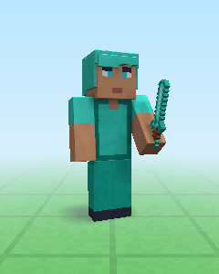

# minecraft-style-video

[English](../../README.md) · [简体中文](../../README.zh-CN.md) · **繁體中文** · [日本語](README.ja.md) · [한국어](README.ko.md) · [Español](README.es.md) · [Français](README.fr.md) · [Deutsch](README.de.md) · [Português](README.pt-BR.md) · [Русский](README.ru.md)

鎖定《Minecraft》`8×8×8` 角色與 `16×16×16` 方塊像素網格比例，生成 9:16 直式短影音分鏡、三視圖設定與多模型提示詞。

直接讓影片生成模型產出「Minecraft 小人挖鑽石」或「搭方塊小屋」，畫面常出現四類跑偏：手部長出五根真人手指、`16×16` 像素格被塗抹成模糊泥塑、鑽石鎬與鑽石劍退化成圓棍金屬刀刃，或頭部串味成 Roblox 圓桶頭與樂高鉤爪。`minecraft-style-video` 在產生動態前先把體素與方塊幾何鎖死：`8×8×8` 直角立方體頭、`+0.5px` 懸浮 3D 外層皮膚、`8×12×4` 軀幹、末端為 `4×4`（Steve）或 `3×4`（Alex）平頭方形截面的長方體手臂、`16×16×16` 鄰近取樣方塊、`14×14×14` 上翻蓋銀鎖儲物箱與 `16×16×1` 階梯擠出像素工具。



## 快速開始

複製到本地 Skills 目錄（支援 Claude Code、Codex、Cursor 與 GitHub Copilot）：

```bash
git clone https://github.com/yuzhang-zhong/minecraft-style-video.git ~/.codex/skills/minecraft-style-video
```

四個命令列腳本僅依賴 Node.js 18+ 標準函式庫；僅在本地重新合成 `.gif` 與 `.mp4` 預覽樣片時需要 `ffmpeg`。

在 Agent 中呼叫 `$minecraft-style-video`：

```text
使用 $minecraft-style-video 規劃一支 15 秒 9:16 等距建造短片：Alex 在草方塊木屋放上工作台、銀鎖儲物箱和發光燈籠，旁邊趴著粉紅六角恐龍。請提供角色與方塊設定卡、參考圖提示詞與 Kling I2V 四鏡頭分鏡表。
```

## 效果預覽與 6 套短片案例

| 角色三視圖設定卡 (`0° / 45° / 90°`) | 防串味幾何對比 (`× 跑偏` vs. `✓ 標準像素`) |
| :---: | :---: |
|  |  |

| 01 · 挖鑽石遇苦力怕 (`Kling`) | 02 · 微縮木屋點亮燈籠 (`Seedance`) | 03 · 鑽石大佬 vs 萌新 TNT (`Hailuo`) |
| :---: | :---: | :---: |
|  |  |  |
| [分鏡表](../../examples/diamond-creeper-ambush/assets/storyboard_contact_sheet.zh.png) · [MP4](../../examples/diamond-creeper-ambush/assets/diamond_creeper_ambush.mp4) · [目錄](../../examples/diamond-creeper-ambush/) | [分鏡表](../../examples/cozy-lantern-build/assets/cozy_storyboard_sheet.zh.png) · [MP4](../../examples/cozy-lantern-build/assets/cozy_lantern_build.mp4) · [目錄](../../examples/cozy-lantern-build/) | [分鏡表](../../examples/pro-builder-vs-noob-tnt/assets/tnt_storyboard_sheet.zh.png) · [MP4](../../examples/pro-builder-vs-noob-tnt/assets/pro_builder_vs_noob_tnt.mp4) · [目錄](../../examples/pro-builder-vs-noob-tnt/) |
| **04 · 紅石黏性活塞連環 (`Wan`)** | **05 · 終界使者偷草方塊 (`Sora`)** | **06 · 雨夜收留六角恐龍 (`Runway`)** |
|  |  |  |
| [分鏡表](../../examples/redstone-chain-asmr/assets/redstone_storyboard_sheet.zh.png) · [MP4](../../examples/redstone-chain-asmr/assets/redstone_chain_asmr.mp4) · [目錄](../../examples/redstone-chain-asmr/) | [分鏡表](../../examples/enderman-block-heist/assets/enderman_storyboard_sheet.zh.png) · [MP4](../../examples/enderman-block-heist/assets/enderman_block_heist.mp4) · [目錄](../../examples/enderman-block-heist/) | [分鏡表](../../examples/axolotl-rainy-shelter/assets/axolotl_storyboard_sheet.zh.png) · [MP4](../../examples/axolotl-rainy-shelter/assets/axolotl_rainy_shelter.mp4) · [目錄](../../examples/axolotl-rainy-shelter/) |

## 經典角色、生物與方塊素材庫

收錄於 [`assets/library/catalog.json`](../../assets/library/catalog.json) 與 [`references/classic-minecraft-catalog.md`](../../references/classic-minecraft-catalog.md)：

| Classic Steve | Slim Alex | Diamond Knight | Cozy Hoodie | Creeper | Enderman |
| :---: | :---: | :---: | :---: | :---: | :---: |
|  |  |  |  |  |  |

| Grass Block | Diamond Ore | TNT Block | Crafting Table | Hinged Chest | Sticky Piston | Pickaxe | Sword |
| :---: | :---: | :---: | :---: | :---: | :---: | :---: | :---: |
|  |  |  |  |  |  |  |  |

## 命令列工具與生成邊界

- [`scripts/voxel_spec.mjs`](../../scripts/voxel_spec.mjs)：產生角色、生物與方塊 DNA 設定卡及參考圖提示詞。
- [`scripts/shot_compiler.mjs`](../../scripts/shot_compiler.mjs)：編譯 9:16 分鏡與 `kling`、`seedance`、`hailuo`、`wan`、`sora`、`runway` 提示詞。
- [`scripts/drift_check.mjs`](../../scripts/drift_check.mjs)：檢查真人五指、圓棍工具、貼圖模糊與動作超載，輸出修補版提示詞。
- [`scripts/render_preview.mjs`](../../scripts/render_preview.mjs)：本地渲染 3D 三視圖、素材庫縮圖、雙語分鏡表與 `.gif` / `.mp4` 預覽樣片。

```bash
node scripts/voxel_spec.mjs --archetype steve-miner --object diamond-ore --held-item diamond-pickaxe --lang zh-tw
node scripts/shot_compiler.mjs --template diamond-creeper-ambush --duration 15 --engine kling --lang zh-tw
```

倉庫內的 `.gif` / `.mp4` 為本地確定性 3D 體素預覽，實際擴散影片需在外部影片模型生成。每段 4 至 5 秒片段僅安排一個主要動作。MIT 授權（[LICENSE](../../LICENSE)），與 Mojang Studios 或 Microsoft 無官方關聯。詳見 [`SKILL.md`](../../SKILL.md)。
