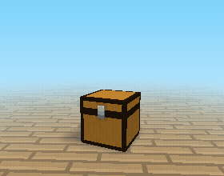
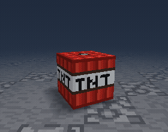

<div align="center">


# Minecraft Style Video

規劃 9:16《Minecraft》體素短片：固定 `8×8×8` 小人與 `16×16×16` 方塊比例，逐鏡編譯提示詞，先在本地預覽動態分鏡。

[](../../skills/minecraft-style-video/SKILL.md)
[](#快速開始)
[](../../LICENSE)

**[短片動畫範例](#短片動畫範例)** · [方塊與道具動效](#方塊與道具動效) · [快速開始](#快速開始) · [Skill 指南](../../skills/minecraft-style-video/SKILL.md)

[English](../../README.md) · [简体中文](../../README.zh-CN.md) · **繁體中文** · [日本語](README.ja.md) · [한국어](README.ko.md) · [Español](README.es.md) · [Français](README.fr.md) · [Deutsch](README.de.md) · [Português](README.pt-BR.md) · [Русский](README.ru.md)

</div>

[](../../assets/showcase/minecraft_shorts_reel.mp4)

## 短片動畫範例

每份分鏡按 15 秒、4 鏡頭規劃。下方的 **4 秒 GIF 與 MP4** 為本地確定性 3D 體素預覽，用於檢查像素比例、構圖與光影切換；最終擴散影片請在對應外部模型中生成。點擊動圖即可開啟含音效的 MP4。

| 01 · 挖鑽石遇苦力怕 (`Kling`) | 02 · 微縮木屋點亮燈籠 (`Seedance`) | 03 · 鑽石大佬 vs 萌新 TNT (`Hailuo`) |
| :---: | :---: | :---: |
| [](../../examples/diamond-creeper-ambush/assets/diamond_creeper_ambush.mp4) | [](../../examples/cozy-lantern-build/assets/cozy_lantern_build.mp4) | [](../../examples/pro-builder-vs-noob-tnt/assets/pro_builder_vs_noob_tnt.mp4) |
| [MP4](../../examples/diamond-creeper-ambush/assets/diamond_creeper_ambush.mp4) · [分鏡圖](../../examples/diamond-creeper-ambush/assets/storyboard_contact_sheet.zh.png) · [提示詞包](../../examples/diamond-creeper-ambush/) | [MP4](../../examples/cozy-lantern-build/assets/cozy_lantern_build.mp4) · [分鏡圖](../../examples/cozy-lantern-build/assets/cozy_storyboard_sheet.zh.png) · [提示詞包](../../examples/cozy-lantern-build/) | [MP4](../../examples/pro-builder-vs-noob-tnt/assets/pro_builder_vs_noob_tnt.mp4) · [分鏡圖](../../examples/pro-builder-vs-noob-tnt/assets/tnt_storyboard_sheet.zh.png) · [提示詞包](../../examples/pro-builder-vs-noob-tnt/) |
| **04 · 紅石黏性活塞連環 (`Wan`)** | **05 · 終界使者偷草方塊 (`Sora`)** | **06 · 雨夜收留六角恐龍 (`Runway`)** |
| [](../../examples/redstone-chain-asmr/assets/redstone_chain_asmr.mp4) | [](../../examples/enderman-block-heist/assets/enderman_block_heist.mp4) | [](../../examples/axolotl-rainy-shelter/assets/axolotl_rainy_shelter.mp4) |
| [MP4](../../examples/redstone-chain-asmr/assets/redstone_chain_asmr.mp4) · [分鏡圖](../../examples/redstone-chain-asmr/assets/redstone_storyboard_sheet.zh.png) · [提示詞包](../../examples/redstone-chain-asmr/) | [MP4](../../examples/enderman-block-heist/assets/enderman_block_heist.mp4) · [分鏡圖](../../examples/enderman-block-heist/assets/enderman_storyboard_sheet.zh.png) · [提示詞包](../../examples/enderman-block-heist/) | [MP4](../../examples/axolotl-rainy-shelter/assets/axolotl_rainy_shelter.mp4) · [分鏡圖](../../examples/axolotl-rainy-shelter/assets/axolotl_storyboard_sheet.zh.png) · [提示詞包](../../examples/axolotl-rainy-shelter/) |

## 方塊與道具動效

針對純物體鏡頭（紅石機關、開箱爆裝、等距方塊建造），鎖定箱蓋轉軸、礦石/紅石燈自發光像素與 `16×16×1` 階梯擠出像素工具：

| 銀鎖儲物箱與 `16×16×1` 工具 | 黏性活塞與紅石燈通電 | `TNT` 引信閃爍與方塊煙霧 |
| :---: | :---: | :---: |
| [](../../assets/showcase/chest_loot_loop.mp4) | [](../../assets/showcase/piston_ore_loop.mp4) | [](../../assets/showcase/tnt_blast_loop.mp4) |
| `14×14×14` 木箱 + 鋸齒鑽石鎬/劍（[MP4](../../assets/showcase/chest_loot_loop.mp4)） | `16×16×16` 黏性活塞 + 發光鑽石礦（[MP4](../../assets/showcase/piston_ore_loop.mp4)） | 4Hz 白光閃爍 + 方塊煙霧粒子（[MP4](../../assets/showcase/tnt_blast_loop.mp4)） |

## 快速開始

複製到本地 Skills 目錄（支援 Codex、GitHub Copilot、Claude Code 與 Cursor）：

```bash
git clone https://github.com/yuzhang-zhong/minecraft-style-video.git ~/.codex/skills/minecraft-style-video
```

或直接在命令列執行（僅需 Node.js 18+ 標準函式庫）：

```bash
node scripts/voxel_spec.mjs --archetype steve-miner --object diamond-ore --held-item diamond-pickaxe --lang zh-tw
node scripts/shot_compiler.mjs --template diamond-creeper-ambush --duration 15 --engine kling --lang zh-tw
node scripts/drift_check.mjs --prompt "A cute Minecraft boy holding a round metal sword with five fingers mines ore and runs away" --engine kling --mode t2v --lang zh-tw
```

## 腳本、限制與參考文件

多鏡頭 I2V 請先以[三視圖設定](../../assets/showcase/steve_alex_turnaround_sheet.zh.png)固定首幀，每段 4 至 5 秒片段僅留一個主要動作（常見跑偏見[防串味對比圖](../../assets/showcase/drift_rescue_comparison.zh.png)與[工作流圖](../pipeline.zh.svg)）。

- [`voxel_spec.mjs`](../../scripts/voxel_spec.mjs) · [`shot_compiler.mjs`](../../scripts/shot_compiler.mjs) · [`drift_check.mjs`](../../scripts/drift_check.mjs) · [`render_preview.mjs`](../../scripts/render_preview.mjs)
- [Skill 指南 (`SKILL.md`)](../../skills/minecraft-style-video/SKILL.md) · [體素與方塊規範](../../references/voxel-geometry-blocks-and-shaders.md) · [各模型提示詞手冊](../../references/model-prompt-playbook.md) · [跑偏修補](../../references/rescue-and-anti-drift.md) · [節奏與音效](../../references/short-video-beats-and-audio.md) · [分鏡模板](../../references/viral-archetypes-catalog.md)

[MIT 授權](../../LICENSE)。獨立開源專案，與 Mojang Studios 或 Microsoft 無隸屬或背書關係。
