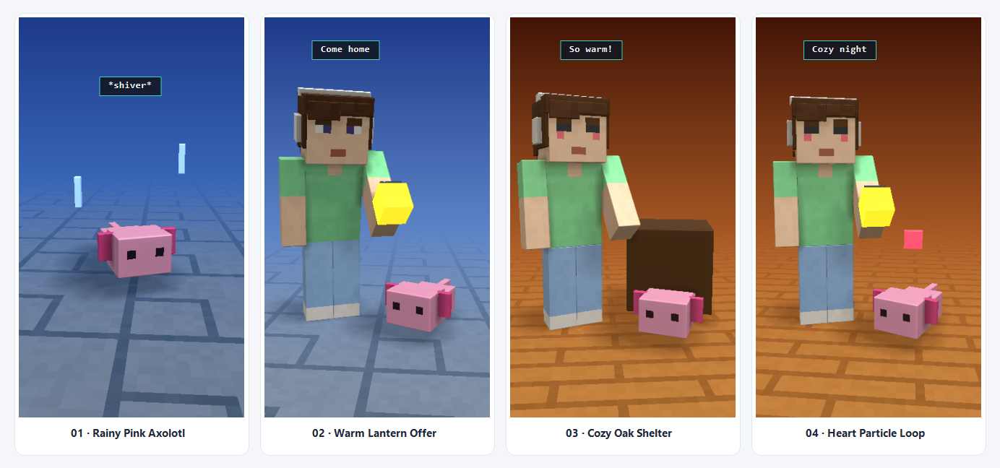

# Case 06 · Rainy Night Pink Voxel Axolotl Rescue (`axolotl-rainy-shelter`)

A 15-second 9:16 cozy story featuring a **Pink Voxel Axolotl** (`3D` pixel external gill fronds), a pastel **3D-Hoodie** character with voxel headphones, and warm Lantern / Redstone Lamp block lighting, compiled for **Runway (`Gen-3 / Gen-4`)** with the `bsl-sunlight` shader.

| 9:16 Animated Preview (`GIF`) | 4-Shot Contact Sheet (`EN`) |
| :---: | :---: |
|  |  |

- [`character_and_object_card.md`](character_and_object_card.md): Cozy 3D Hoodie (`alex-slim`), Pink Axolotl, and Voxel Lantern DNA card.
- [`storyboard.md`](storyboard.md) & [`prompts.json`](prompts.json): 4-shot beat sheet and Runway I2V prompts.
- [Chinese contact sheet](assets/axolotl_storyboard_sheet.zh.png) · [MP4 with audio](assets/axolotl_rainy_shelter.mp4)
