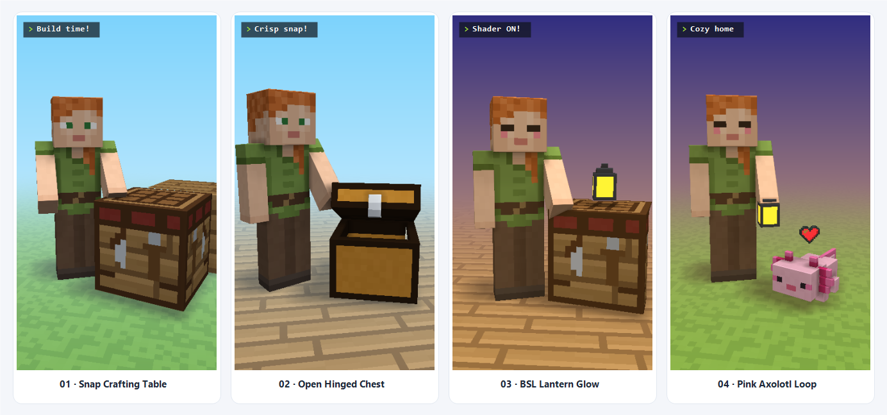

# Case 02 · Cozy Isometric Lantern Cabin Build (`cozy-lantern-build`)

A 15-second 9:16 isometric voxel-build package compiled for **Seedance / Jimeng (`seedance`)** with the `bsl-sunlight` shader (`16x16x16` Grass Block, Crafting Table, `14x14x14` hinged Chest with silver pixel latch, glowing Lantern, and Pink Axolotl).

| 9:16 Animated Preview (`GIF`) | 4-Shot Contact Sheet (`EN`) |
| :---: | :---: |
|  |  |

- [`character_and_object_card.md`](character_and_object_card.md): Slim Alex (`alex-slim`), `16x16x16` Crafting Table, and Voxel Lantern DNA card.
- [`storyboard.md`](storyboard.md) & [`prompts.json`](prompts.json): 4-shot isometric build beat sheet and Seedance prompts.
- [Chinese contact sheet](assets/cozy_storyboard_sheet.zh.png) · [MP4 with audio](assets/cozy_lantern_build.mp4)
