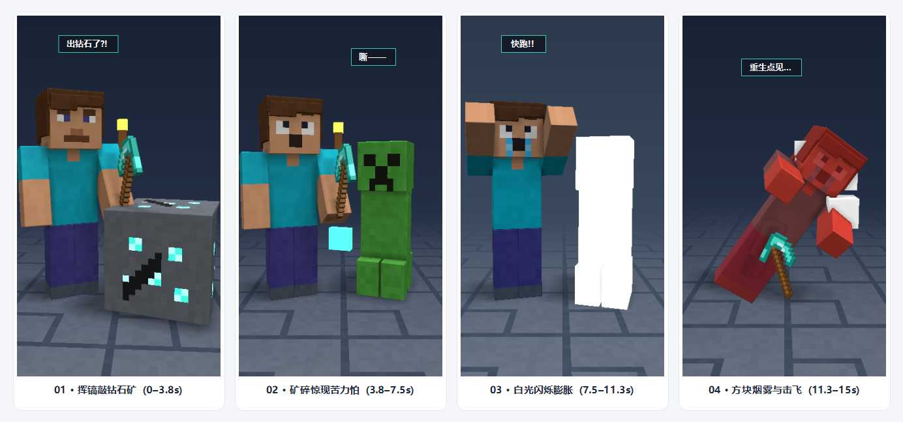

# Case 01 · 挖到钻石秒遇苦力怕 (`diamond-creeper-ambush`)

本目录包含一套完整的 15 秒 9:16 竖屏《我的世界》矿洞反转短片资产包，目标模型为 **可灵 (`Kling I2V`)**，采用 **RTX 矿石与火把自发光 (`rtx-emissive`)** 视觉锁定。

## 渲染成片与分镜预览

| 9:16 动态预览 (`GIF`) | 4 镜头中文分镜联系表 |
| :---: | :---: |
|  |  |

## 文件清单

- [`character_and_object_card.md`](character_and_object_card.md)：矿工 Steve（`8x8x8` 直角立方头、`+0.5px` 3D 像素刘海、`4x12x4` 平头方手）、`16x16x16` 发光钻石矿与 `16x16x1` 挤出像素钻石镐设定卡。
- [`storyboard.md`](storyboard.md)：4 镜头 9:16 分镜表与中英双语首帧/I2V 动态提示词。
- [`prompts.json`](prompts.json)：结构化机器可读提示词输出。
- [`drift_report.md`](drift_report.md)：针对常见草稿词（长出真人手指、圆棍铁镐、单镜多动作超载）的防串味体检与救场重写样例。
- `assets/`：含三视图设定卡、4 张独立镜头首帧（`shot_01_mine.png` 至 `shot_04_blast.png`）、中英分镜联系表、`.gif` 动图与带音效 `.mp4` 短片。
