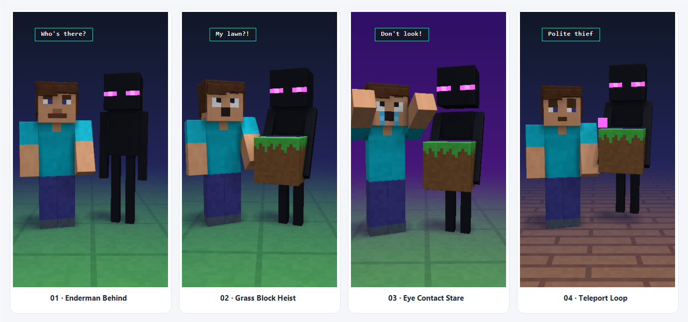

# Case 05 · Enderman Midnight Grass Block Heist (`enderman-block-heist`)

A 15-second 9:16 vertical mob-slapstick short featuring a **3-block-tall Enderman** (`8x8x8` separable cubic jaw, glowing `#D946EF` `3x1` pixel eyes, `2x30x2` stick arms carrying a stolen `16x16x16` Grass Block), compiled for **Sora (`sora`)** with the `bsl-sunlight` shader.

| 9:16 Animated Preview (`GIF`) | 4-Shot Contact Sheet (`EN`) |
| :---: | :---: |
|  |  |

- [`character_and_object_card.md`](character_and_object_card.md): Enderman (`mob-enderman`) and `16x16x16` Grass Block DNA card.
- [`storyboard.md`](storyboard.md) & [`prompts.json`](prompts.json): 4-shot beat sheet and Sora prompts.
- [Chinese contact sheet](assets/enderman_storyboard_sheet.zh.png) · [MP4 with audio](assets/enderman_block_heist.mp4)
