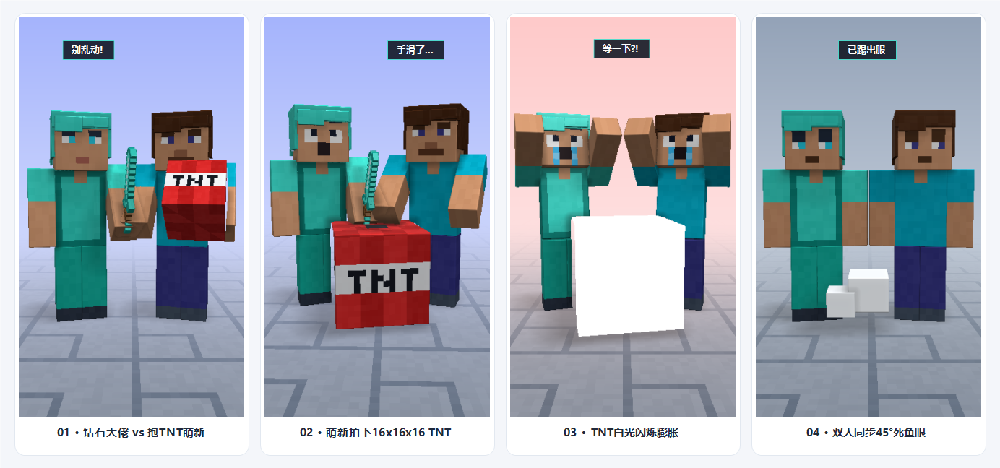

# Case 03 · 红石大佬 vs 熊孩子拍 TNT (`pro-builder-vs-noob-tnt`)

本目录展示双人同框喜剧反差与 `16x16x16` **TNT 方块**引信白光膨胀物理的 15 秒 9:16 竖屏短片资产包，目标模型为 **海螺 (`Hailuo Director I2V`)**，采用 **官方宣传片 (`bare-bones-trailer`)** 纯净像素画风。

## 渲染成片与分镜预览

| 9:16 动态预览 (`GIF`) | 4 镜头中文分镜联系表 |
| :---: | :---: |
|  |  |

## 文件清单

- [`character_and_object_card.md`](character_and_object_card.md)：3D 立体钻石头盔/胸甲大佬、`16x16x1` 挤出像素钻石剑与 `16x16x16` 红白 TNT 炸药块设定卡。
- [`storyboard.md`](storyboard.md)：带海螺 `[Push in]`、`[Shake]` 运镜标签的 4 镜头分镜表。
- [`prompts.json`](prompts.json)：结构化提示词 JSON。
- `assets/`：中英分镜联系表（`tnt_storyboard_sheet.zh.png` / `.en.png`）、`.gif` 动图与带音效 `.mp4` 短片。
