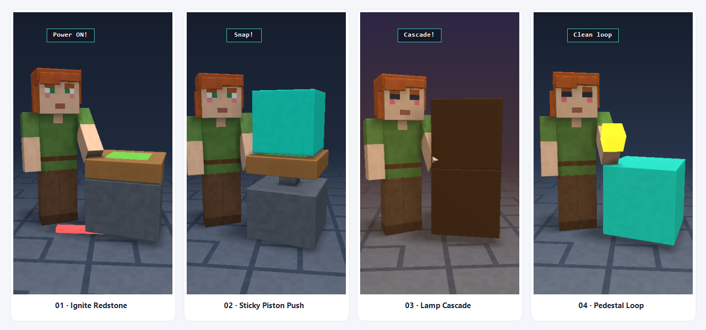

# Case 04 · Redstone & Sticky Piston Chain ASMR (`redstone-chain-asmr`)

A 15-second 9:16 vertical short-video package focused on **pure voxel block mechanics** (`16x16x16` Sticky Piston, glowing `#EF4444` Redstone Dust, Diamond Block, and cascading Redstone Lamps), compiled for **Wan (`Wan 2.1 / 2.6 I2V`)** with the `rtx-emissive` shader.

| 9:16 Animated Preview (`GIF`) | 4-Shot Contact Sheet (`EN`) |
| :---: | :---: |
|  |  |

- [`character_and_object_card.md`](character_and_object_card.md): Alex (`alex-slim`), `16x16x16` Sticky Piston, and Voxel Lantern DNA card.
- [`storyboard.md`](storyboard.md) & [`prompts.json`](prompts.json): 4-shot beat sheet and Wan I2V prompts.
- [Chinese contact sheet](assets/redstone_storyboard_sheet.zh.png) · [MP4 with audio](assets/redstone_chain_asmr.mp4)
