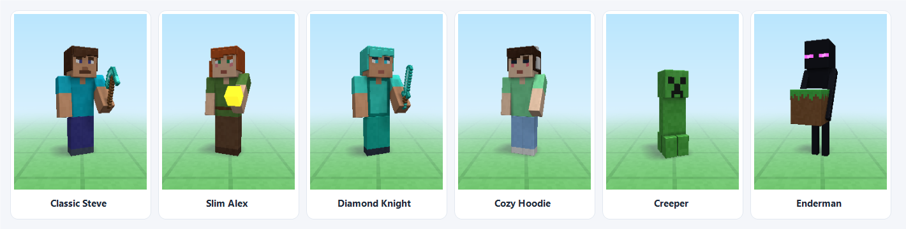
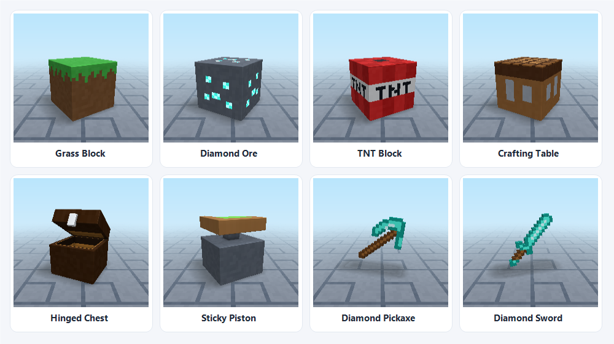

# Classic Minecraft Characters, Mobs, Blocks, and Extruded Tools Library

All visual references in this catalog are pre-rendered in [`assets/library/`](../assets/library/catalog.json) and [`assets/showcase/`](../assets/showcase/), and their geometry tokens are wired directly into `scripts/voxel_spec.mjs` and `scripts/render_preview.mjs`.

## 1. Six Iconic Characters & Mobs (`classic_characters_lineup.en.png`)

| Preset ID | Name & Rig | Locked Pixel Proportions & Outer Layer | Asset |
| --- | --- | --- | --- |
| `steve-miner` | **Classic Steve (`steve-wide`)** | `8x8x8` cube head + `+0.5px` brown bangs, cyan `8x12x4` tunic, `4x12x4` wide arms with `4x4` square hand ends, `16x16x1` Diamond Pickaxe | [`char_steve.png`](../assets/library/characters/char_steve.png) |
| `alex-builder` | **Slim Alex (`alex-slim`)** | `8x8x8` cube head + `+0.5px` ginger side-ponytail, moss-green `8x12x4` tunic, `3x12x4` slim arms with `3x4` square hands, warm voxel Lantern | [`char_alex.png`](../assets/library/characters/char_alex.png) |
| `diamond-knight` | **Diamond Armor Pro (`steve-wide`)** | `+0.6px` 3D `#4AEDD9` Diamond Helmet & Chestplate shell over `8x12x4` torso, holding `16x16x1` stepped Diamond Sword | [`char_knight.png`](../assets/library/characters/char_knight.png) |
| `cozy-hoodie` | **Cozy 3D Hoodie (`alex-slim`)** | Pastel matcha hoodie with `+0.5px` espresso bangs and white 3D voxel headphones over ears | [`char_hoodie.png`](../assets/library/characters/char_hoodie.png) |
| `creeper-mob` | **Creeper (`mob-quadruped`)** | `8x8x8` head with `8x8` black frowning pixel face, `8x12x4` vertical body, **zero arms**, four `4x6x4` legs | [`mob_creeper.png`](../assets/library/characters/mob_creeper.png) |
| `enderman-mob` | **Enderman (`mob-enderman`)** | Jet-black `8x8x8` separable jaw head with glowing `#D946EF` `3x1` pixel eyes, thin `2x30x2` stick limbs carrying a `16x16x16` Grass Block | [`mob_enderman.png`](../assets/library/characters/mob_enderman.png) |

## 2. Eight Canonical Voxel Blocks, Props & Extruded Tools (`classic_objects_atlas.en.png`)

| Object / Item ID | Grid Dimensions | Key Anti-Drift Details | Asset |
| --- | --- | --- | --- |
| `grass-block` | `16 × 16 × 16` px (`1m³`) | Crisp green top grid + stepped `2–5px` green grass side overhang over brown dirt texels | [`block_grass.png`](../assets/library/objects/block_grass.png) |
| `diamond-ore` | `16 × 16 × 16` px (`1m³`) | Stone `16x16` matrix embedded with emissive `#4AEDD9` cyan diamond pixel clusters on all faces | [`block_diamond_ore.png`](../assets/library/objects/block_diamond_ore.png) |
| `tnt-block` | `16 × 16 × 16` px (`1m³`) | Red/orange vertical dynamite stripes, `4px` white center band reading `TNT` in pixel font, top grey fuse | [`block_tnt.png`](../assets/library/objects/block_tnt.png) |
| `crafting-table` | `16 × 16 × 16` px (`1m³`) | `3x3` crafting grid on top face + pixel saw and hammer hanging on oak plank sides | [`block_crafting_table.png`](../assets/library/objects/block_crafting_table.png) |
| `chest-hinged` | `14 × 14 × 14` px (`0.875m³`) | Hollow oak base, upward-hinged top lid seam at `y=10px`, protruding 3D silver `2x4` pixel front latch | [`prop_chest.png`](../assets/library/objects/prop_chest.png) |
| `redstone-piston` | `16 × 16 × 16` px (`1m³`) | Cobblestone pixel base + extendable `4px` wooden plunger head coated with green slime texels | [`prop_piston.png`](../assets/library/objects/prop_piston.png) |
| `diamond-pickaxe` | `16 × 16 × 1` px extruded | Diagonal oak pixel stick + `#4AEDD9` cyan pick head with 90-degree staircase edges (never a round rod) | [`item_diamond_pickaxe.png`](../assets/library/objects/item_diamond_pickaxe.png) |
| `diamond-sword` | `16 × 16 × 1` px extruded | Stepped 90-degree `#4AEDD9` cyan pixel blade + pixel crossguard extruded `1px` thick | [`item_diamond_sword.png`](../assets/library/objects/item_diamond_sword.png) |
